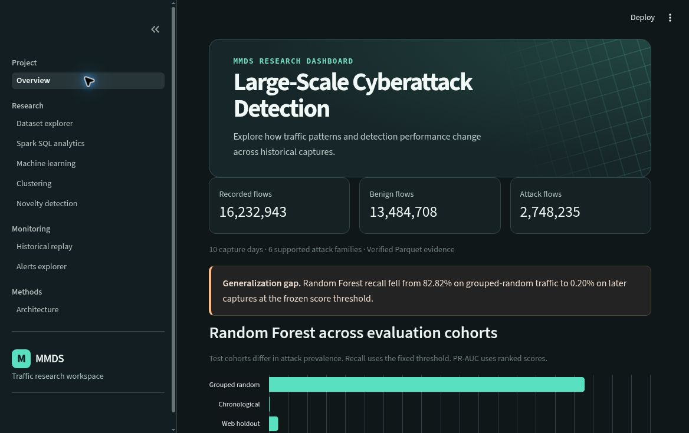

# large-scale-cyberattack-detection-mmds
Large-Scale Cyberattack Detection and Evolving Attack Pattern Mining using Apache Spark, PySpark, Spark MLlib and Kaggle.

## Phase 0 environment verification

Run the synthetic Spark smoke test from the repository root in Codex Cloud:

```bash
source .venv/bin/activate
SPARK_LOCAL_IP=127.0.0.1 python -m unittest discover -s tests -v
```

See the [verification guide](docs/environment_verification.md) for dependency setup and the private Kaggle CPU notebook procedure. The [status report](reports/environment_status.md) records the observed results and remaining integration blockers.

## Phase 1 dataset audit

The audit measures the ten version 1 captures on Kaggle CPU. It separates data records from headers, blank lines and malformed lines, and retains original labels and headers. The [audit report](reports/dataset_audit.md), [schema reference](docs/dataset_schema.md), and [research feasibility assessment](docs/dataset_feasibility.md) contain the results.

To regenerate the self-contained notebook and exercise its audit code against synthetic fixtures:

```bash
python scripts/build_phase1_notebook.py
SPARK_LOCAL_IP=127.0.0.1 python -m unittest discover -s tests -v
```

The Phase 1 submission uses a temporary copy of the private CPU manifest from Phase 0B with the authenticated owner, title `MMDS Phase 1 Dataset Audit`, ID `owner/mmds-phase-1-dataset-audit`, and code file `phase1_dataset_audit.ipynb`. Confirm that the Kaggle dataset is version 1 and that its mounted inventory matches `configs/dataset.yaml`. The notebook writes compact JSON markers under `/kaggle/working/mmds_phase1`. Parsed disk caches and fingerprint intermediates stay in `/kaggle/temp`.

Use the Kaggle CLI setup in the [integration guide](docs/environment_verification.md) to submit and monitor a version. After the run finishes, the same web API retrieves the archive and extracts the audit markers:

```bash
python scripts/kaggle_web_api.py kernels logs "$kernel/$version" > "$run_dir/audit.log"
python scripts/kaggle_web_api.py phase1-output "$kernel/$version" "$run_dir/audit"
python scripts/render_phase1_audit.py "$run_dir/audit" \
  --kernel-url "https://www.kaggle.com/code/$kernel" --version "$version" --status COMPLETE
```

For a bounded retry, set `ONLY_DAYS` in a temporary notebook to the unfinished ISO capture dates. Retrieve completed versions' JSON separately and retain the source version for each recovered file. A caught per-file error leaves earlier stage markers available in the finished archive. An interrupted worker may lose unpublished markers. Global fingerprint metrics require one run with all captures present. Use `scripts/build_phase1_notebook.py --exact-duplicates --output PATH` for the independent full-value duplicate pass. Pass its extracted directory and verified version to the renderer with `--exact-source` and `--exact-version`.

## Phase 2 typed Parquet

Phase 2 builds and validates a raw-aligned layer, a clean layer, and a feature-ready base layer in private Kaggle CPU. See the [data contract](docs/data_contract.md), [cleaning policy](docs/cleaning_policy.md), [saved output reuse](docs/parquet_storage.md), and [execution report](reports/phase2_data_engineering.md).

For local verification, activate the project virtual environment and install PyArrow in addition to the Phase 0 dependencies. Build the self-contained notebook and run the tests with the same Spark version as Kaggle.

```bash
python -m pip install pyarrow
python scripts/build_phase2_notebook.py
SPARK_LOCAL_IP=127.0.0.1 python -m unittest discover -s tests -v
```

## Phase 3 Spark SQL analytics

Phase 3 queries the verified Phase 2 Notebook Output in private Kaggle CPU. See the [analytics results](reports/phase3_analytics.md), [methodology](docs/phase3_methodology.md), [pattern findings](docs/attack_pattern_findings.md), and [research readiness](reports/phase3_research_readiness.md). Local tests use Spark, PyArrow, and Matplotlib. Rebuild the bundled notebook with `python scripts/build_phase3_notebook.py`.

## Phase 4 supervised evaluation

Phase 4 compares majority and duration baselines, Logistic Regression, Random Forest and Gradient-Boosted Trees on three prespecified grouped or capture-held-out protocols. It reads the verified Phase 2 Notebook Output. See the [protocol](docs/phase4_experimental_protocol.md), [measured results](reports/phase4_supervised_results.md), and [model manifest](manifests/phase4_models.json). Build each version with `python scripts/build_phase4_notebook.py --protocol A|B|C --output PATH`.

## Phase 5 clustering and pattern evolution

Phase 5 compares global retrospective and reference-trained K-Means fits on the verified Phase 2 Notebook Output. See the [design](docs/phase5_clustering_protocol.md), [measured results and figures](reports/phase5_clustering_results.md), and [pattern analysis](docs/phase5_pattern_evolution.md). Build notebook versions using `python scripts/build_phase5_notebook.py --experiment G|B|C --output PATH`.

## Phase 6 historical Structured Streaming replay

Phase 6 replays the retained chronological B cohorts with the frozen Phase 4 classifiers and the frozen Phase 5 K-Means pipeline. See the [replay protocol](docs/phase6_replay_protocol.md), [results and figures](reports/phase6_streaming_results.md), and [interpretation](docs/phase6_drift_interpretation.md). Build the replay notebook with `python scripts/build_phase6_notebook.py`. Build its private model mirror with `python scripts/build_phase6_model_mirror.py PATH` using the configured Kaggle credentials. Attach the verified Phase 2 output and the model mirror listed in the run manifest.

## Phase 7 faculty dashboard

The Streamlit dashboard connects the audited Parquet corpus, Spark SQL analysis, supervised benchmarks, K-Means novelty analysis, and historical streaming replay through verified aggregate evidence. It includes a prediction explorer and filtered historical alert downloads.

```sh
python -m venv .dashboard-venv
source .dashboard-venv/bin/activate
python -m pip install -r dashboard/requirements.txt
python scripts/validate_dashboard_package.py
python -m streamlit run dashboard/app.py
```

Open the local address printed by Streamlit. The maintainer provided a [public Streamlit URL](https://large-scale-cyberattack-detection-mmds-jbsvxctpmtssjjcbeaky6d.streamlit.app/). Public verification of the final QA revision remains pending because the Codex Cloud proxy blocked the connection. [Deployment settings](docs/dashboard_deployment.md) · [Quick start](docs/dashboard_quickstart.md) · [Architecture](docs/system_architecture.md)

Random Forest test recall fell from 82.82% on grouped-random traffic to 0.20% on later captures at threshold 0.5. Web novelty flags reached 55.78% recall at 1.50% precision. Historical replay covered 15,322,987 retained flows in 49 microbatches, with 102 monitoring records. These measures characterize the dataset, evaluation cohorts and single-node historical replay. Live detection efficacy and concept drift require additional evidence.

[Final academic report](docs/final_project_report.md) · [Faculty demo guide](docs/faculty_demo_guide.md) · [Presentation and notes](docs/final_presentation/outline.md) · [Viva](docs/viva_questions.md) · [Evidence manifest](manifests/dashboard_package.json)



[Chronological model comparison screenshot](docs/screenshots/chronological.jpg)

[Final dashboard QA and responsive screenshots](reports/dashboard_final_qa.md)
