# Large-Scale Cyberattack Detection and Evolving Attack Pattern Mining


Student:[editable]

Registration:[editable]

Supervisor:[editable]

Institution/programme/year:[editable]


## Abstract
This project evaluates leakage-aware cyberattack detection and evolving traffic patterns on a 16,232,943-flow source release and a 2,830,743-flow external mirror. Spark engineering, supervised and novelty models, open-set diagnostics, frequent patterns, historical drift, delayed-label adaptation and explainable inference are assessed with versioned evidence. Strong grouped-random results coexist with weak chronological recall; hybrid and adaptive policies show mixed trade-offs. External evaluation uses three conditionally compatible predictors and preserves source-only versus target-trained distinctions. Forty-eight volume/worker measurements, 16 warm-ups and 130 optimization measurements show workload-dependent performance: at one million matched rows, Pandas takes 0.242 seconds versus Spark 0.616 seconds for the measured query. A separate dashboard executes archived LR, RF and K-Means with 2,445 Spark parity probes. The contribution is an auditable experimental and software chain, not a production detector or a state-of-the-art claim.


Keywords:Apache Spark;intrusion detection;temporal generalization;concept drift;adaptive learning;explainability;reproducibility


## Table of contents
1. Introduction
2. Problem statement
3. Motivation
4. Research objectives
5. Literature review and related work
6. Research gaps
7. Proposed system
8. System architecture
9. Dataset description and exploratory analysis
10. Distributed data-engineering methodology
11. Spark SQL and descriptive traffic analytics
12. Supervised attack detection
13. Clustering and novelty detection
14. Hybrid detection
15. Multiclass and open-set classification
16. Frequent and emerging pattern mining
17. Historical streaming and drift detection
18. Advanced drift-monitoring evidence
19. Adaptive learning
20. Explainable AI
21. External validation
22. Scalability and execution optimization
23. Integrated dashboard and interactive inference
24. Experimental results and comparative analysis
25. Research contributions
26. Scientific and technical limitations
27. Conclusion
28. Future work
29. References
30. Appendices and reproducibility instructions


## 1. Introduction

Network intrusion research often reports high held-out accuracy without asking whether the evaluation resembles future captures. This project treats data provenance, split design and operating thresholds as part of the scientific problem. It studies the exact MMDS Kaggle release and a separately documented CICIDS2017 mirror, preserving original population counts and the uncertainty of their upstream extraction chains.

The work combines Spark engineering, supervised and novelty models, family rejection, pattern mining, retrospective drift analysis, delayed-label adaptive policies and a validated demonstration application. Its central result is not that a complex detector solves cyberattack detection. It is that numerical correctness, random-split ranking, future operating-point recall and deployable model compatibility are distinct claims that require different evidence.

The report follows that distinction throughout. The source corpus contains 16,232,943 flows; purged chronological test cohorts, the 15,322,987-flow historical replay, the 1,997,636-row adaptive primary evaluation and the 308,939-row primary external test are not interchangeable denominators. All comparisons retain their declared feature sets, training budgets, calibration rules and label availability.


## 2. Problem statement

Given a heterogeneous historical flow corpus, construct reproducible numerical layers and evaluate whether detectors trained on earlier or grouped observations maintain useful attack recall at a defensible benign false-positive burden. Extend the analysis to unfamiliar families and external data without assuming that similar column names imply identical measurement semantics.

A second problem is engineering assurance: every displayed result should be traceable to a versioned input, model, transform, threshold and evaluation denominator. A third is computational: measure actual workload actions under a constrained single-machine Spark environment, separating data-volume, thread, storage and cache effects from unsupported multi-node or production claims.


## 3. Motivation

Correlated duplicate flows can make a row-random split unrealistically easy. Class imbalance can make majority predictions look accurate, while a model with useful ranking can still miss almost every attack at its operational threshold. Marginal distribution alarms can also reflect capture composition rather than a changed decision boundary. These failure modes motivate a study that retains negative findings and unsupported claims instead of selecting only a favorable result.

The academic motivation is to connect algorithms with experimental discipline. The engineering motivation is to provide auditable artifacts and a usable demonstration that computes real predictions rather than replaying static labels. The project does not promise a live network sensor, autonomous defense or a production security service.


## 4. Research objectives

The objectives are: audit the exact released population; create reusable typed and finite Spark layers; separate grouped-random, chronological and holdout performance; evaluate reference novelty and hybrid policies on matched cohorts; distinguish family-stage diagnostics from upstream binary misses; mine frequent and emerging associations with explicit supports; study historical signals and controlled synthetic changes separately; enforce predict-before-label-release adaptation; reconstruct supported explanations; evaluate conditional common-feature external models; measure bounded scalability workloads; and expose verified archived inference in an isolated application.

Success is defined by reproducible evidence and completed acceptance gates, not a minimum accuracy chosen after observing results. An unsupported feature contract, undefined metric or failed engineering version is recorded explicitly. Public deployment and prospective effectiveness are outside the completed experimental scope.


## 5. Literature review and related work

Spark supplies a unified processing model and MLlib provides reusable learning pipelines [1,2]. Random forests and gradient boosting are established ensemble methods [3,4]; neither algorithm's reputation guarantees performance on a temporally different flow population. FP-growth supplies a compact frequency-mining strategy [5]. The present project uses these algorithms as reproducible components, not as newly invented methods.

ADWIN and concept-drift literature motivate explicit change-monitoring assumptions [6,7]. Controlled synthetic episode labels allow delay and stationary-alarm evaluation, whereas the historical captures have no authoritative concept-drift ground truth. Precision–recall analysis is relevant under class imbalance [9], but the study reports both ranking and frozen-threshold decisions rather than treating one curve as sufficient.

SHAP gives an additive attribution framework [10]. Here exact interventional linear contributions are validated in log-odds, while unsupported direct tree explanations are omitted. TESSERACT studies spatial and temporal evaluation bias in malware classification [11]; it motivates caution about experiment design but is not an intrusion-detection baseline or a quantitative comparator for these flow results.

CICIDS2017 is documented by its dataset paper and institutional release [8,12]. The accessible Kaggle mirror is version-pinned and audited, while byte identity to an official archive and exact extractor builds remain unverified. Related work therefore informs methodology and terminology; this report makes no state-of-the-art comparison or publication-acceptance claim.


## 6. Research gaps

The project addresses a reproducibility gap between a favorable model score and the evidence needed to interpret it. The relevant gaps are incomplete cohort accounting, leakage through repeated predictor vectors, unseparated threshold effects, unsupported feature harmonization, retrospective labels described as online learning, attribution without reconstruction checks, and performance claims based on unconsumed lazy actions.

The contribution is an integrated, traceable case study across these concerns. It does not claim to be the first use of Spark, random forests, drift detection or explainable intrusion analysis. The strongest supported novelty is project-level experimental integration and transparent negative-result evidence, not a new learning-theoretic algorithm.


## 7. Proposed system

The system separates private data engineering, scientific evaluation and public demonstration artifacts. Private Kaggle CPU jobs verify pinned inputs and persist fitted pipelines plus compact aggregate receipts. Independent verification checks numerical reconstructions, calibration, model components and scope counts. Git stores approved aggregates, source/configuration, model identities and bounded portable parameters, not raw private flow records.

The advanced application reads immutable evidence and verifies its own model artifacts before computing manual or bounded CSV predictions. It does not call Kaggle or fit preprocessing on uploaded values. The academic submission reuses those accepted outputs and adds only conceptual architecture diagrams, editorial synthesis and document-quality verification.


## 8. System architecture

The end-to-end architecture has six boundaries: input provenance, audited numerical representation, experimental role assignment, fitted/scored research components, immutable evidence/model registries and consumer-facing artifacts. Each boundary has an explicit contract. This is important because a correct classifier can still be evaluated on the wrong population, and a correct table can still be mislabeled in a dashboard.

Training-only transforms and frozen operating thresholds constrain information flow. Historical replay preserves archived order without implying live monitoring. Adaptive candidates become active only in a future window after allowed labels and calibration are available. Portable inference preserves original parameters but does not create a new empirical generalization claim.


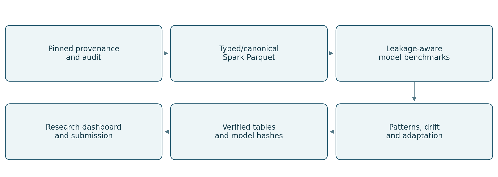


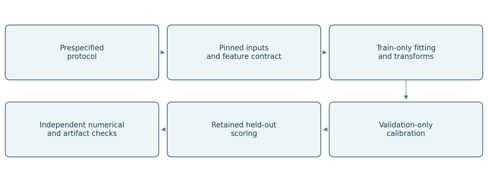


## 9. Dataset description and exploratory analysis

This section consolidates the accepted dataset description and exploratory analysis investigation. The original protocol,cohort definitions and limits remain authoritative. No experiment was rerun for this academic report.

Kaggle version 1 reached `COMPLETE`. The audit completed 10 of 10 expected captures and counted 10. [Private CPU notebook](https://www.kaggle.com/code/ramcharan2345/mmds-phase-1-dataset-audit)

Dataset `saisathwikregula/mmds-dataset-23013`, version 1. The mounted inventory contains 10 files and 6,886,649,507 bytes. [Inventory](../manifests/dataset_inventory.json)

Inventory flags record 0 missing, 0 unreadable, 0 unexpected, 0 duplicate-basename and 0 size-mismatch entries.

### Records

| Capture | Mounted bytes | Columns | Data records | Parsed | Malformed | Blank | Headers | Status |
| --- | --- | --- | --- | --- | --- | --- | --- | --- |
| 2018-02-14 | 358,223,333 | 80 | 1,048,575 | 1,048,575 | 0 | 0 | 1 | complete |
| 2018-02-15 | 375,945,899 | 80 | 1,048,575 | 1,048,575 | 0 | 0 | 1 | complete |
| 2018-02-16 | 333,723,605 | 80 | 1,048,574 | 1,048,574 | 0 | 0 | 2 | complete |
| 2018-02-20 | 4,054,925,350 | 84 | 7,948,748 | 7,948,748 | 0 | 0 | 1 | complete |
| 2018-02-21 | 328,893,673 | 80 | 1,048,575 | 1,048,575 | 0 | 0 | 1 | complete |
| 2018-02-22 | 382,636,202 | 80 | 1,048,575 | 1,048,575 | 0 | 0 | 1 | complete |
| 2018-02-23 | 382,840,456 | 80 | 1,048,575 | 1,048,575 | 0 | 0 | 1 | complete |
| 2018-02-28 | 209,249,758 | 80 | 613,071 | 613,071 | 0 | 0 | 34 | complete |
| 2018-03-01 | 107,842,858 | 80 | 331,100 | 331,100 | 0 | 0 | 26 | complete |
| 2018-03-02 | 352,368,373 | 80 | 1,048,575 | 1,048,575 | 0 | 0 | 1 | complete |

Measured captures contain 16,233,012 physical lines, including 16,232,943 data records, 69 header lines (59 repeats) and 0 blank lines. Spark parsed 16,232,943 data records. Malformed records total 0, including 0 width or quoting failures and 0 Spark corrupt records. Counts use one record per physical line, with the exact original header line classified separately wherever it repeats. No source records were modified. [File statistics](dataset_file_statistics.csv)

### Labels

Measured label groups cover 16,232,943 parsed rows. The proposed mapping yields 13,484,708 benign rows (83.070014%), 2,748,235 attack rows (16.929986%), and 0 unmapped rows (0.000000%). Original spellings and all capture-specific counts are retained. The CSV stores the original label as JSON so null and empty strings stay distinct. [Label distribution](dataset_label_distribution.csv)

| Original label | Rows | Share | Capture days | Largest capture share | Proposed group |
| --- | --- | --- | --- | --- | --- |
| `"Benign"` | 13,484,708 | 83.070014% | 2018-02-14, 2018-02-15, 2018-02-16, 2018-02-20, 2018-02-21, 2018-02-22, 2018-02-23, 2018-02-28, 2018-03-01, 2018-03-02 | 54.673464% | Benign |
| `"DDOS attack-HOIC"` | 686,012 | 4.226048% | 2018-02-21 | 100.000000% | DDoS |
| `"DDoS attacks-LOIC-HTTP"` | 576,191 | 3.549517% | 2018-02-20 | 100.000000% | DDoS |
| `"DoS attacks-Hulk"` | 461,912 | 2.845522% | 2018-02-16 | 100.000000% | DoS |
| `"Bot"` | 286,191 | 1.763026% | 2018-03-02 | 100.000000% | Bot |
| `"FTP-BruteForce"` | 193,360 | 1.191158% | 2018-02-14 | 100.000000% | Credential brute force |
| `"SSH-Bruteforce"` | 187,589 | 1.155607% | 2018-02-14 | 100.000000% | Credential brute force |
| `"Infilteration"` | 161,934 | 0.997564% | 2018-02-28, 2018-03-01 | 57.469710% | Infiltration |
| `"DoS attacks-SlowHTTPTest"` | 139,890 | 0.861766% | 2018-02-16 | 100.000000% | DoS |
| `"DoS attacks-GoldenEye"` | 41,508 | 0.255702% | 2018-02-15 | 100.000000% | DoS |
| `"DoS attacks-Slowloris"` | 10,990 | 0.067702% | 2018-02-15 | 100.000000% | DoS |
| `"DDOS attack-LOIC-UDP"` | 1,730 | 0.010657% | 2018-02-21 | 100.000000% | DDoS |
| `"Brute Force -Web"` | 611 | 0.003764% | 2018-02-22, 2018-02-23 | 59.247136% | Web attack |
| `"Brute Force -XSS"` | 230 | 0.001417% | 2018-02-22, 2018-02-23 | 65.652174% | Web attack |
| `"SQL Injection"` | 87 | 0.000536% | 2018-02-22, 2018-02-23 | 60.919540% | Web attack |

Proposed attack-family totals

| Family | Rows | Share of measured labels | Share of mapped attacks |
| --- | --- | --- | --- |
| Bot | 286,191 | 1.763026% | 10.413629% |
| Credential brute force | 380,949 | 2.346765% | 13.861588% |
| DDoS | 1,263,933 | 7.786222% | 45.990718% |
| DoS | 654,300 | 4.030692% | 23.808008% |
| Infiltration | 161,934 | 0.997564% | 5.892291% |
| Web attack | 928 | 0.005717% | 0.033767% |

Observed normalized-label collisions across distinct originals: 0. Original labels with leading, trailing or repeated whitespace: 0. A family mapping is a proposal and leaves unknown names unmapped.

### Timestamps

The audit tries the configured DMY day-first and ISO patterns in order. A separate MDY parse flags alternative interpretations. All date comparisons use wall-clock timestamps without timezone (`TIMESTAMP_NTZ`). Spark's session timezone was UTC for determinism. Source timezone and clock synchronization were not established.

| Capture | Parsed / rows | Range | Missing | Invalid | Ambiguous DMY/MDY | Name disagreement |
| --- | --- | --- | --- | --- | --- | --- |
| 2018-02-14 | 1,048,575 / 1,048,575 (100.000000%) | 1970-01-05 03:01:17 to 2018-02-14 12:59:59 | 0 | 0 | 5 | 5 |
| 2018-02-15 | 1,048,575 / 1,048,575 (100.000000%) | 2018-02-15 01:00:00 to 2018-02-15 12:59:59 | 0 | 0 | 0 | 0 |
| 2018-02-16 | 1,048,574 / 1,048,574 (100.000000%) | 2018-02-16 01:00:32 to 2018-02-16 12:58:24 | 0 | 0 | 0 | 0 |
| 2018-02-20 | 7,948,748 / 7,948,748 (100.000000%) | 2018-02-20 01:00:00 to 2018-02-20 12:59:59 | 0 | 0 | 0 | 0 |
| 2018-02-21 | 1,048,575 / 1,048,575 (100.000000%) | 2018-02-21 01:55:46 to 2018-02-21 10:43:21 | 0 | 0 | 0 | 0 |
| 2018-02-22 | 1,048,575 / 1,048,575 (100.000000%) | 1970-01-10 03:04:26 to 2018-02-22 12:59:59 | 0 | 0 | 9 | 9 |
| 2018-02-23 | 1,048,575 / 1,048,575 (100.000000%) | 2018-02-23 01:00:00 to 2018-02-23 12:59:59 | 0 | 0 | 0 | 0 |
| 2018-02-28 | 613,071 / 613,071 (100.000000%) | 2018-02-28 01:00:00 to 2018-02-28 12:59:59 | 0 | 0 | 0 | 0 |
| 2018-03-01 | 331,100 / 331,100 (100.000000%) | 2018-03-01 01:00:00 to 2018-03-01 12:59:59 | 0 | 0 | 331,100 | 0 |
| 2018-03-02 | 1,048,575 / 1,048,575 (100.000000%) | 2018-03-02 01:00:00 to 2018-03-02 12:59:59 | 0 | 0 | 1,048,575 | 0 |

The parser accepted 16,232,943 of 16,232,943 timestamp cells (100.000000%). There were 14 filename-date disagreements and 1,379,689 valid alternative MDY interpretations. The MDY parse matched the filename date for 0 rows.

Observed dates outside their filename capture days were 1970-01-05 (1), 1970-01-08 (1), 1970-01-10 (1), 1970-01-11 (3), 1970-01-12 (8).

The [timestamp table](dataset_timestamp_summary.csv) retains per-date and per-format counts, plus MDY-only and MDY-match totals.

### Quality

Across 804 file-column profiles, measured nulls total 0 and empty or whitespace-only strings total 0. The Spark parser can represent empty source fields as null depending on CSV quoting.

Numeric candidates contain 59,721 NaNs, 131,799 infinities, and 0 conversion failures. Fields governed by a nonnegative rule contain 106 invalid negative cells. Initial TCP-window fields are excluded from that rule because their negative sentinel requires separate interpretation.

There are 96 constant nonempty feature profiles and 139 feature profiles with a sampled dominant-value fraction of at least 99%. The deterministic content sample uses `pmod(xxhash64(23013, raw_line), 1000) = 0`. Exact repeats enter or miss the sample together. [Quality statistics](dataset_quality_summary.csv)

Kaggle version 2 grouped all 16,232,943 parsed arrays by full string-value equality within 2 original schemas. It found 107,670 duplicate groups, 410,707 excess copies and 0 cross-day duplicate groups. The exact stage took 509.978 s. [Kaggle notebook](https://www.kaggle.com/code/ramcharan2345/mmds-phase-1-dataset-audit)

Fingerprint coverage includes 10 captures. Full parsed-line SHA-256 grouping found 107,670 duplicate groups containing 410,707 excess copies. This measures identical source-line fingerprints, including cross-file matches. Hash collisions were not independently byte-verified.

Schema-scoped fingerprints of nonidentity, nontimestamp feature values found 22,129 groups with different original labels, involving 419,528 rows. Coarse flow-metric bucketing found 778 mixed-feature buckets with 8,591 participating rows among 16,247 eligible sampled rows. The heuristic uses available flow duration, forward/backward packet counts and packet-length totals, and mean flow inter-arrival time. It groups duration and inter-arrival measurements in intervals of 1,000 source units, and packet and byte measures in intervals of 10. Bucket matches indicate similarity on those fields within the sample.

### Spark execution

Spark settings `{"driver_memory": "8g", "executor_cores": 2, "input_partition_bytes": 67108864, "master": "local[2]", "shuffle_partitions": 32, "spark_application": "mmds-phase-1-dataset-audit", "timestamp_type": "TIMESTAMP_NTZ", "timezone": "UTC", "version": "4.3.0"}`.

The measured audit loop took 2722.49 s.

Global fingerprint aggregation took 109.678 s.

The Kaggle API returned persisted execution logs for version 1 (1,253 log events) and version 2 (230 log events).

| Capture | Parse and count (s) | Label and time (s) | Quality (s) | Fingerprint staging (s) |
| --- | --- | --- | --- | --- |
| 2018-02-14 | 53.685 | 15.529 | 69.781 | 14.767 |
| 2018-02-15 | 55.933 | 15.586 | 74.083 | 16.34 |
| 2018-02-16 | 52.391 | 16.365 | 71.734 | 15.756 |
| 2018-02-20 | 479.613 | 117.845 | 598.646 | 121.639 |
| 2018-02-21 | 51.238 | 16.345 | 73.641 | 15.906 |
| 2018-02-22 | 55.807 | 15.818 | 70.577 | 15.629 |
| 2018-02-23 | 54.861 | 15.579 | 60.253 | 14.286 |
| 2018-02-28 | 40.675 | 12.622 | 52.546 | 10.837 |
| 2018-03-01 | 25.383 | 4.835 | 47.785 | 7.795 |
| 2018-03-02 | 55.485 | 5.431 | 71.732 | 19.478 |

See [the schema reference](../docs/dataset_schema.md) and [the feasibility assessment](../docs/dataset_feasibility.md).


Evidence source:reports/dataset_audit.md


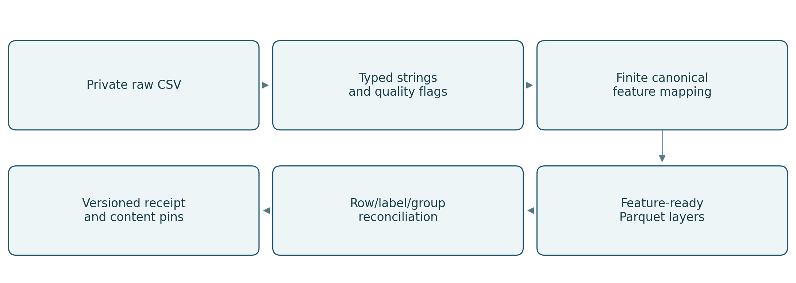


## 10. Distributed data-engineering methodology

This section consolidates the accepted distributed data-engineering methodology investigation. The original protocol,cohort definitions and limits remain authoritative. No experiment was rerun for this academic report.

### Input reconciliation

| Capture day | Expected records | Canonical records | Expected header lines | Observed header lines | Repeated header lines |
| --- | --- | --- | --- | --- | --- |
| 2018-03-01 | 331,100 | 331,100 | 26 | 26 | 25 |
| 2018-02-28 | 613,071 | 613,071 | 34 | 34 | 33 |
| 2018-02-21 | 1,048,575 | 1,048,575 | 1 | 1 | 0 |
| 2018-02-16 | 1,048,574 | 1,048,574 | 2 | 2 | 1 |
| 2018-03-02 | 1,048,575 | 1,048,575 | 1 | 1 | 0 |
| 2018-02-14 | 1,048,575 | 1,048,575 | 1 | 1 | 0 |
| 2018-02-15 | 1,048,575 | 1,048,575 | 1 | 1 | 0 |
| 2018-02-22 | 1,048,575 | 1,048,575 | 1 | 1 | 0 |
| 2018-02-23 | 1,048,575 | 1,048,575 | 1 | 1 | 0 |
| 2018-02-20 | 7,948,748 | 7,948,748 | 1 | 1 | 0 |

The completed captures contain 16,233,012 physical lines and 16,232,943 data records. Spark counted 69 header lines, including 59 repeats, and 0 blank lines. The width/quoting and corrupt-record counters were 0 and 0. [Count evidence](phase2_count_reconciliation.csv)

### Cleaning and labels

The canonical label totals were 13,484,708 benign and 2,748,235 attack. There were 0 unknown labels. 14 records retained an outside-capture-day timestamp and were marked temporally ineligible.

Numeric diagnostics cover 8,257,114 distinct rows and 12,879,783 cells. Schema-only nulls cover 8,284,195 rows and 33,136,780 cells.

| Reason | Affected rows | Affected cells | Action |
| --- | --- | --- | --- |
| nan | 59,721 | 59,721 | nullify |
| positive_infinity | 95,760 | 131,799 | nullify |
| negative_infinity | 0 | 0 | nullify |
| invalid_negative | 15 | 106 | nullify |
| sentinel | 8,255,549 | 12,688,157 | nullify |
| cast_failure | 0 | 0 | typed_null |
| source_null | 0 | 0 | retain_null |

The independent mount validated 12,879,783 stored policy nullifications and re-counted the benign and attack classes directly in each primary layer.

The diagnostic policy kept all primary records. It measured 107,670 exact digest groups and 410,707 excess copies. Cleaned shared features produced 21,763 conflicting-label groups involving 710,014 rows. Phase 1's 22,129 groups refer to its own raw-feature definition. [Cell actions](phase2_quality_actions.csv)

### Parquet output

| Layer | Producer path | Day partitions | Files | Bytes | Records |
| --- | --- | --- | --- | --- | --- |
| raw_aligned | `/kaggle/working/mmds_phase2/phase2-v1/raw_aligned` | 10 | 55 | 2,712,371,594 | 16,232,943 |
| clean | `/kaggle/working/mmds_phase2/phase2-v1/clean` | 10 | 55 | 2,708,993,526 | 16,232,943 |
| feature_ready | `/kaggle/working/mmds_phase2/phase2-v1/feature_ready` | 10 | 53 | 3,003,003,600 | 16,232,943 |

The worker inspected data-file footers and verified Snappy compression and row totals. [Parquet manifest](../manifests/parquet_layers.json)

### Performance

Spark 4.3.0 used `local[4]`, an 8g driver heap, 48 configured shuffle partitions and 64 MiB input splits. Kaggle exposed 4 logical CPUs in the process affinity mask.

The producer loop took 2,629.032 s. Reading, parsing and materializing the canonical data took 1,686.290 s at 3.89 MiB/s effective input throughput. The timing includes CSV conversion and the disk-backed canonical materialization.

| Layer | Write time including lazy transformations (s) |
| --- | --- |
| raw_aligned | 240.044 |
| clean | 297.806 |
| feature_ready | 314.859 |

The JVM high-water resident set was 5.39 GiB. This includes JVM memory outside the configured heap. [Per-file performance](phase2_performance.csv)

Global duplicate diagnostics took 72.760 s.

### Spark SQL, DataFrame and RDD

All three methods returned the same 3 protocol groups over 311 records. The sample rule was `smallest capture by source bytes; pmod(xxhash64(record_fingerprint), 1024) == 0`.

| Protocol | Records | Attacks |
| --- | --- | --- |
| 0.0 | 4 | 0 |
| 6.0 | 210 | 68 |
| 17.0 | 97 | 17 |

<details><summary>SQL physical plan</summary>

```text
AdaptiveSparkPlan isFinalPlan=true
+- == Final Plan ==
   ResultQueryStage 2
   +- *(2) HashAggregate(keys=[protocol#80055], functions=[count(1), sum(binary_label#80134)], output=[protocol#80055, records#80150L, attacks#80151L])
      +- AQEShuffleRead coalesced
         +- ShuffleQueryStage 1
            +- Exchange hashpartitioning(protocol#80055, 48), ENSURE_REQUIREMENTS, [plan_id=1682]
               +- *(1) HashAggregate(keys=[knownfloatingpointnormalized(normalizenanandzero(protocol#80055)) AS protocol#80055], functions=[partial_count(1), partial_sum(binary_label#80134)], output=[protocol#80055, count#80232L, sum#80233L])
                  +- TableCacheQueryStage 0
                     +- InMemoryTableScan [protocol#80055, binary_label#80134]
                           +- InMemoryRelation [protocol#80055, binary_label#80134], StorageLevel(disk, memory, deserialized, 1 replicas)
                                 +- *(1) Project [protocol#80055, binary_label#80134]
                                    +- *(1) Filter (pmod(xxhash64(record_fingerprint#80136, 42), 1024) = 0)
                                       +- *(1) ColumnarToRow
                                          +- FileScan parquet [protocol#80055,binary_label#80134,record_fingerprint#80136] Batched: true, DataFilters: [(pmod(xxhash64(record_fingerprint#80136, 42), 1024) = 0)], Format: Parquet, Location: InMemoryFileIndex(1 paths)[file:/kaggle/working/mmds_phase2/phase2-v1/feature_ready/source_day=20..., PartitionFilters: [], PushedFilters: [], ReadSchema: struct<protocol:double,binary_label:tinyint,record_fingerprint:binary>
+- == Initial Plan ==
   HashAggregate(keys=[protocol#80055], functions=[count(1), sum(binary_label#80134)], output=[protocol#80055, records#80150L, attacks#80151L])
   +- Exchange hashpartitioning(protocol#80055, 48), ENSURE_REQUIREMENTS, [plan_id=1652]
      +- HashAggregate(keys=[knownfloatingpointnormalized(normalizenanandzero(protocol#80055)) AS protocol#80055], functions=[partial_count(1), partial_sum(binary_label#80134)], output=[protocol#80055, count#80232L, sum#80233L])
         +- InMemoryTableScan [protocol#80055, binary_label#80134]
               +- InMemoryRelation [protocol#80055, binary_label#80134], StorageLevel(disk, memory, deserialized, 1 replicas)
                     +- *(1) Project [protocol#80055, binary_label#80134]
                        +- *(1) Filter (pmod(xxhash64(record_fingerprint#80136, 42), 1024) = 0)
                           +- *(1) ColumnarToRow
                              +- FileScan parquet [protocol#80055,binary_label#80134,record_fingerprint#80136] Batched: true, DataFilters: [(pmod(xxhash64(record_fingerprint#80136, 42), 1024) = 0)], Format: Parquet, Location: InMemoryFileIndex(1 paths)[file:/kaggle/working/mmds_phase2/phase2-v1/feature_ready/source_day=20..., PartitionFilters: [], PushedFilters: [], ReadSchema: struct<protocol:double,binary_label:tinyint,record_fingerprint:binary>
```

</details>

<details><summary>DataFrame physical plan</summary>

```text
AdaptiveSparkPlan isFinalPlan=true
+- == Final Plan ==
   ResultQueryStage 2
   +- *(2) HashAggregate(keys=[protocol#80055], functions=[count(1), sum(binary_label#80134)], output=[protocol#80055, records#80154L, attacks#80155L])
      +- AQEShuffleRead coalesced
         +- ShuffleQueryStage 1
            +- Exchange hashpartitioning(protocol#80055, 48), ENSURE_REQUIREMENTS, [plan_id=1739]
               +- *(1) HashAggregate(keys=[knownfloatingpointnormalized(normalizenanandzero(protocol#80055)) AS protocol#80055], functions=[partial_count(1), partial_sum(binary_label#80134)], output=[protocol#80055, count#80289L, sum#80290L])
                  +- TableCacheQueryStage 0
                     +- InMemoryTableScan [protocol#80055, binary_label#80134]
                           +- InMemoryRelation [protocol#80055, binary_label#80134], StorageLevel(disk, memory, deserialized, 1 replicas)
                                 +- *(1) Project [protocol#80055, binary_label#80134]
                                    +- *(1) Filter (pmod(xxhash64(record_fingerprint#80136, 42), 1024) = 0)
                                       +- *(1) ColumnarToRow
                                          +- FileScan parquet [protocol#80055,binary_label#80134,record_fingerprint#80136] Batched: true, DataFilters: [(pmod(xxhash64(record_fingerprint#80136, 42), 1024) = 0)], Format: Parquet, Location: InMemoryFileIndex(1 paths)[file:/kaggle/working/mmds_phase2/phase2-v1/feature_ready/source_day=20..., PartitionFilters: [], PushedFilters: [], ReadSchema: struct<protocol:double,binary_label:tinyint,record_fingerprint:binary>
+- == Initial Plan ==
   HashAggregate(keys=[protocol#80055], functions=[count(1), sum(binary_label#80134)], output=[protocol#80055, records#80154L, attacks#80155L])
   +- Exchange hashpartitioning(protocol#80055, 48), ENSURE_REQUIREMENTS, [plan_id=1709]
      +- HashAggregate(keys=[knownfloatingpointnormalized(normalizenanandzero(protocol#80055)) AS protocol#80055], functions=[partial_count(1), partial_sum(binary_label#80134)], output=[protocol#80055, count#80289L, sum#80290L])
         +- InMemoryTableScan [protocol#80055, binary_label#80134]
               +- InMemoryRelation [protocol#80055, binary_label#80134], StorageLevel(disk, memory, deserialized, 1 replicas)
                     +- *(1) Project [protocol#80055, binary_label#80134]
                        +- *(1) Filter (pmod(xxhash64(record_fingerprint#80136, 42), 1024) = 0)
                           +- *(1) ColumnarToRow
                              +- FileScan parquet [protocol#80055,binary_label#80134,record_fingerprint#80136] Batched: true, DataFilters: [(pmod(xxhash64(record_fingerprint#80136, 42), 1024) = 0)], Format: Parquet, Location: InMemoryFileIndex(1 paths)[file:/kaggle/working/mmds_phase2/phase2-v1/feature_ready/source_day=20..., PartitionFilters: [], PushedFilters: [], ReadSchema: struct<protocol:double,binary_label:tinyint,record_fingerprint:binary>
```

</details>

<details><summary>RDD lineage</summary>

```text
(4) PythonRDD[403] at collect at /kaggle/temp/mmds_phase2/source/src/sql/aggregation_demo.py:19 []
 |  MapPartitionsRDD[386] at mapPartitions at PythonRDD.scala:197 []
 |  ShuffledRDD[385] at partitionBy at DirectMethodHandleAccessor.java:103 []
 +-(4) PairwiseRDD[384] at reduceByKey at /kaggle/temp/mmds_phase2/source/src/sql/aggregation_demo.py:17 []
    |  PythonRDD[383] at reduceByKey at /kaggle/temp/mmds_phase2/source/src/sql/aggregation_demo.py:17 []
    |  MapPartitionsRDD[382] at javaToPython at DirectMethodHandleAccessor.java:103 []
    |  MapPartitionsRDD[381] at javaToPython at DirectMethodHandleAccessor.java:103 []
    |  SQLExecutionRDD[380] at javaToPython at DirectMethodHandleAccessor.java:103 []
    |  MapPartitionsRDD[379] at javaToPython at DirectMethodHandleAccessor.java:103 []
    |  MapPartitionsRDD[378] at javaToPython at DirectMethodHandleAccessor.java:103 []
    |  MapPartitionsRDD[377] at javaToPython at DirectMethodHandleAccessor.java:103 []
    |  *(1) Project [protocol#80055, binary_label#80134]
+- *(1) Filter (pmod(xxhash64(record_fingerprint#80136, 42), 1024) = 0)
   +- *(1) ColumnarToRow
      +- FileScan parquet [protocol#80055,binary_label#80134,record_fingerprint#80136] Batched: true, DataFilters: [(pmod(xxhash64(record_fingerprint#80136, 42), 1024) = 0)], Format: Parquet, Location: InMemoryFileIndex(1 paths)[file:/kaggle/working/mmds_phase2/phase2-v1/feature_ready/source_day=20..., PartitionFilters: [], PushedFilters: [], ReadSchema: struct<protocol:double,binary_label:tinyint,record_fingerprint:binary>
 MapPartitionsRDD[376] at javaToPython at DirectMethodHandleAccessor.java:103 []
    |      CachedPartitions: 4; MemorySize: 2.9 KiB; DiskSize: 0.0 B
    |  MapPartitionsRDD[375] at javaToPython at DirectMethodHandleAccessor.java:103 []
    |  MapPartitionsRDD[374] at javaToPython at DirectMethodHandleAccessor.java:103 []
    |  MapPartitionsRDD[373] at javaToPython at DirectMethodHandleAccessor.java:103 []
    |  FileScanRDD[372] at javaToPython at DirectMethodHandleAccessor.java:103 []
```

</details>

### Saved output reuse

Version 1 of the private verification notebook mounted the saved producer output as a notebook input. It matched the expected evidence SHA-256 and directly verified each layer. Independent validation took 101.019 s. [Verification notebook](https://www.kaggle.com/code/ramcharan2345/mmds-phase-2-parquet-reuse-check) · [Storage guide](../docs/parquet_storage.md)


Evidence source:reports/phase2_data_engineering.md


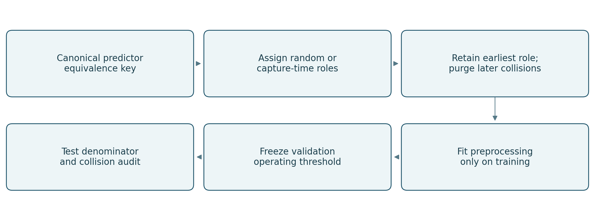


## 11. Spark SQL and descriptive traffic analytics

This section consolidates the accepted spark sql and descriptive traffic analytics investigation. The original protocol,cohort definitions and limits remain authoritative. No experiment was rerun for this academic report.

### Input validation

Phase 2 output version 1 matched saved receipt `1fa00cd2b9c853ee33eaacee8ca7632dbb41f739573326280d6ffbfb2ccff25a` and policy `phase2-v1`. Spark reconciled labels, original-label family mappings and temporal eligibility across the clean and feature-ready layers. The feature-ready schema contained 77 canonical model candidates. [Validation evidence](phase3_validation.json)

| Layer | Mounted path | Partitions | Records |
| --- | --- | --- | --- |
| feature_ready | `/kaggle/input/notebooks/ramcharan2345/mmds-phase-2-spark-data-engineering/mmds_phase2/phase2-v1/feature_ready` | 10 | 16,232,943 |
| clean | `/kaggle/input/notebooks/ramcharan2345/mmds-phase-2-spark-data-engineering/mmds_phase2/phase2-v1/clean` | 10 | 16,232,943 |
| raw_aligned | `/kaggle/input/notebooks/ramcharan2345/mmds-phase-2-spark-data-engineering/mmds_phase2/phase2-v1/raw_aligned` | 10 | 16,232,943 |

### Traffic and temporal counts

13,484,708 records were benign and 2,748,235 (16.930%) were labeled attack. The largest attack count was 687,742 on 2018-02-21. Attack prevalence ranged from 0.0345% on 2018-02-22 to 65.5883% on 2018-02-21. [Daily traffic](phase3_daily_traffic.csv)

| Population | Packet count | Byte count |
| --- | --- | --- |
| attack | 306,194,295 | 10,852,060,785 |
| benign | 178,292,446 | 81,740,137,674 |

Eligible event-time queries retained 16,232,929 records and excluded 14 timestamp outliers. The 93 observed hourly groups included a peak of 686,012 attack records on 2018-02-21 at 02:00 local wall time. Source timezone is unverified. Capture-day groups include all rows. Empty or unobserved hours are left out of the hourly table. [Hourly traffic](phase3_hourly_traffic.csv) · [Three-hour windows](phase3_time_windows.csv)

### Families and flow statistics

| Family | Attack records | Share of attacks | Capture days | Rows with nonsentinel issues |
| --- | --- | --- | --- | --- |
| DDoS | 1,263,933 | 45.991% | 2 | 0 |
| DoS | 654,300 | 23.808% | 2 | 0 |
| Credential brute force | 380,949 | 13.862% | 1 | 6 |
| Bot | 286,191 | 10.414% | 1 | 0 |
| Infiltration | 161,934 | 5.892% | 2 | 1,295 |
| Web attack | 928 | 0.034% | 2 | 0 |

Approximate flow quantiles use Spark percentile accuracy 4,096. The feature tables also contain finite-value counts, means, sample standard deviations and extrema. [By binary label](phase3_feature_statistics.csv) · [By family](phase3_family_feature_statistics.csv) · [Original labels](phase3_original_labels.csv)

| Measure | Benign P50 | Attack P50 | Benign P99 | Attack P99 |
| --- | --- | --- | --- | --- |
| flow_duration | 3.421e+04 | 1.076e+04 | 1.183e+08 | 8.342e+07 |
| total_packets | 3 | 2 | 70 | 44 |
| total_bytes | 174 | 0 | 3.142e+04 | 4,625 |
| flow_iat_mean | 1.426e+04 | 4,588 | 8.625e+07 | 3.98e+07 |
| flow_pkts_s | 104.3 | 383.7 | 2e+06 | 2e+06 |

Aggregate IP protocol counts were code 6.0 (11,800,335), code 17.0 (4,194,295), code 0.0 (238,313). [Protocol by family](phase3_protocols.csv) · [Top destination ports](phase3_destination_ports.csv)

### Data-quality sensitivity

Exact duplicate groups contained 518,377 occurrences. A representative-per-exact-content count would be 15,822,236, removing 410,707 excess copies from that count. The Phase 2 cleaned-feature conflict groups contained 710,014 rows (4.374%) across 21,763 groups. Default Phase 3 statistics preserve full multiplicity. [Duplicate and anomaly summary](phase3_duplicate_quality.csv)

| Feature | Raw NaN | Raw infinity | Raw minus one | Clean nulls |
| --- | --- | --- | --- | --- |
| flow_byts_s | 59,721 | 36,039 | 0 | 95,760 |
| flow_pkts_s | 0 | 95,760 | 0 | 95,774 |
| init_fwd_win_byts | 0 | 0 | 4,432,608 | 4,432,608 |
| init_bwd_win_byts | 0 | 0 | 8,255,549 | 8,255,549 |
| flow_duration | 0 | 0 | 0 | 14 |

Finite means and class-specific counts are retained in the sensitivity tables. [Raw-aligned](phase3_raw_sensitivity.csv) · [Clean](phase3_clean_sensitivity.csv)

### Performance

Spark 4.3.0 used `local[4]`, 8g configured driver heap, 48 configured shuffle partitions and 64 MiB input splits. The notebook took 620.821s from input validation to chart generation. Input validation took 67.009s. JVM high-water RSS was 4.59 GiB.

| API | Measured runs (s) | Median (s) |
| --- | --- | --- |
| SQL | 2.958, 2.991, 2.983 | 2.983 |
| DataFrame | 3.038, 2.984, 2.983 | 2.984 |

The bounded SQL, DataFrame and RDD comparison agreed on 311 records. The full-data benchmark warmed each API and alternated execution order over the same cached inputs. [Measured query timings](phase3_query_performance.csv) · [Physical plans and RDD lineage](phase3_execution_plans.json)

### Figures

- [Binary distribution](figures/phase3_binary_distribution.png)
- [Attack family frequencies](figures/phase3_attack_family_frequencies.png)
- [Daily traffic volume](figures/phase3_daily_traffic_volume.png)
- [Daily attack prevalence](figures/phase3_daily_attack_prevalence.png)
- [Family by capture day](figures/phase3_family_by_capture_day.png)
- [Flow duration comparison](figures/phase3_flow_duration_comparison.png)
- [Packet byte distributions](figures/phase3_packet_byte_distributions.png)
- [Protocol distribution](figures/phase3_protocol_distribution.png)
- [Destination ports](figures/phase3_destination_ports.png)
- [Temporal feature changes](figures/phase3_temporal_feature_changes.png)

[Candidate pattern findings](../docs/attack_pattern_findings.md) · [Research readiness](phase3_research_readiness.md)


Evidence source:reports/phase3_analytics.md


## 12. Supervised attack detection

This section consolidates the accepted supervised attack detection investigation. The original protocol,cohort definitions and limits remain authoritative. No experiment was rerun for this academic report.

### Input and cohort integrity

Each run verified 16,232,943 input records across ten capture days, with 13,484,708 benign and 2,748,235 attack. The pinned Phase 2 receipt and cleaning version matched, and the 14 timestamp-flagged records remain eligible for capture-day assignment. The primary version registers 18 shared numerical predictors and fits preprocessing only on training-group samples. All evaluation predictions use the retained population. [Protocol specification](../docs/phase4_experimental_protocol.md)

| Protocol | Train | Validation | Test | Purged | Train sample | Sample share of train |
| --- | --- | --- | --- | --- | --- | --- |
| A | 11,455,925 | 2,344,726 | 2,432,292 | 0 | 695,307 | 6.069% |
| B | 13,191,622 | 1,151,256 | 980,109 | 909,956 | 795,270 | 6.029% |
| C | 13,522,722 | 392,902 | 1,458,218 | 859,101 | 812,520 | 6.009% |

Attack prevalence in retained cohorts

| Protocol | Train | Validation | Test | Train sample |
| --- | --- | --- | --- | --- |
| A | 17.7161% | 15.1220% | 14.9702% | 14.9856% |
| B | 17.4319% | 4.9560% | 21.2757% | 16.3886% |
| C | 19.8069% | 10.6495% | 0.0451% | 18.8579% |

The retained cohorts had zero crossing primary, exact-record or Phase 2 cleaned-feature groups. Imputed vectors were audited separately. [Day, binary and original-label support](phase4_split_diagnostics.csv)

| Protocol | Crossing predictor groups before purge | Crossing imputed vectors | Rows in those imputed groups |
| --- | --- | --- | --- |
| A | 0 | 0 | 0 |
| B | 136,985 | 0 | 0 |
| C | 142,016 | 0 | 0 |

### Test metrics

PR-AUC is binned average precision. Blank denominators appear as dashes. Baseline setup is included in overall runtime and its reported fit time excludes cutoff calibration. [Validation and test metrics with confusion matrices](phase4_metrics.csv)

| Protocol | Model | PR-AUC | ROC-AUC | Precision | Recall | F1 | Balanced accuracy |
| --- | --- | --- | --- | --- | --- | --- | --- |
| A | Majority | 0.1497 | 0.5000 | — | 0.0000 | 0.0000 | 0.5000 |
| A | Duration rule | 0.1659 | 0.5541 | 0.1758 | 0.6196 | 0.2739 | 0.5541 |
| A | Logistic Regression | 0.5931 | 0.8064 | 0.9848 | 0.0009 | 0.0018 | 0.5004 |
| A | Random Forest | 0.9166 | 0.9656 | 0.9313 | 0.8282 | 0.8767 | 0.9087 |
| A | GBT | 0.8892 | 0.9577 | 0.9282 | 0.8496 | 0.8872 | 0.9190 |
| A | Logistic Regression (full refit) | 0.2833 | 0.7521 | 0.0161 | 0.0038 | 0.0062 | 0.4814 |
| B | Majority | 0.2128 | 0.5000 | — | 0.0000 | 0.0000 | 0.5000 |
| B | Duration rule | 0.4075 | 0.7760 | 0.4481 | 0.8276 | 0.5814 | 0.7760 |
| B | Logistic Regression | 0.6232 | 0.8225 | 0.7763 | 0.0008 | 0.0017 | 0.5004 |
| B | Random Forest | 0.6036 | 0.7986 | 0.0790 | 0.0020 | 0.0039 | 0.4978 |
| B | GBT | 0.2188 | 0.4297 | 0.1478 | 0.0058 | 0.0112 | 0.4984 |
| B | Logistic Regression (full refit) | 0.6496 | 0.8276 | 0.8964 | 0.0038 | 0.0075 | 0.5018 |
| C | Majority | 0.0005 | 0.5000 | — | 0.0000 | 0.0000 | 0.5000 |
| C | Duration rule | 0.0004 | 0.4422 | 0.0002 | 0.1079 | 0.0004 | 0.4422 |
| C | Logistic Regression | 0.0012 | 0.3606 | 0.0004 | 0.0015 | 0.0007 | 0.5000 |
| C | Random Forest | 0.0005 | 0.5063 | 0.0013 | 0.0243 | 0.0025 | 0.5081 |
| C | GBT | 0.0007 | 0.4777 | 0.0012 | 0.0410 | 0.0024 | 0.5130 |
| C | Logistic Regression (full refit) | 0.0013 | 0.3645 | 0.0000 | 0.0000 | 0.0000 | 0.4998 |

### Execution

| Protocol | Kaggle version | Runtime (s) | Spark | CPU workers | Driver heap | JVM peak GiB | Log events |
| --- | --- | --- | --- | --- | --- | --- | --- |
| A | 1 | 517.592 | 4.3.0 | 4 | 8g | 6.96 | 952 |
| B | 2 | 745.004 | 4.3.0 | 4 | 8g | 6.27 | 1091 |
| C | 3 | 491.052 | 4.3.0 | 4 | 8g | 6.93 | 836 |

[Fit and validation-scoring timings](phase4_training_performance.csv) · [Family and original-label recall](phase4_family_recall.csv) · [Model comparison](../docs/phase4_model_comparison.md)


Evidence source:reports/phase4_supervised_results.md


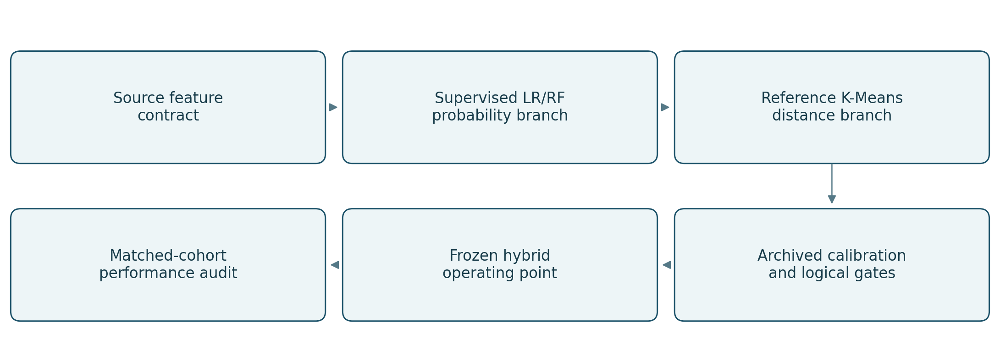


## 13. Clustering and novelty detection

This section consolidates the accepted clustering and novelty detection investigation. The original protocol,cohort definitions and limits remain authoritative. No experiment was rerun for this academic report.

### Input and cohorts

Each run validated the Phase 2 version 1 receipt, cleaning policy, ten dates and 16,232,943 flows, including 13,484,708 benign and 2,748,235 attack. The 18-feature registry contains no labels, identifiers, ports, protocol or day fields. The historical and scenario cohorts match the corresponding Phase 4 retained binary and family counts. [Cohort evidence](phase5_cohorts.csv)

| Experiment | Retained rows | Overlap rows purged | Fit rows | Fit share | Silhouette/calibration rows |
| --- | --- | --- | --- | --- | --- |
| G | 16,232,943 | 0 | 390,702 | 2.4068% | 18,099 |
| B | 15,322,987 | 909,956 | 318,175 | 2.4119% | 14,426 |
| C | 15,373,842 | 859,101 | 323,731 | 2.3940% | 15,229 |

### K-Means and robustness

| Experiment | Selected k | Probe silhouette | Fit WSSSE | Fit time (s) | Seed ARI | Linear vs log ARI |
| --- | --- | --- | --- | --- | --- | --- |
| G | 5 | 0.6179 | 2,224,306.1 | 15.082 | 0.8955 | 0.2900 |
| B | 12 | 0.6289 | 826,131.4 | 13.601 | 0.8504 | 0.2183 |
| C | 12 | 0.6029 | 856,400.4 | 12.038 | 0.7974 | 0.4202 |

The bounded silhouette selected among k = 3, 5, 8 and 12 on a disjoint reference probe. WSSSE is the fitted sample objective. ARI uses the same probe and compares label-free assignments. The linear and signed-log objectives are measured in different feature spaces. [All trial sizes, iterations and memory snapshots](phase5_model_selection.csv)

### External label composition

| Experiment | Largest cluster | Records | Attack share | Highest attack-share cluster | Attack share |
| --- | --- | --- | --- | --- | --- |
| G | 4 | 5,269,424 | 9.5207% | 0 | 35.9252% |
| B | 0 | 3,367,057 | 0.9917% | 1 | 65.5958% |
| C | 1 | 3,315,657 | 0.9757% | 8 | 50.3938% |

Cluster IDs are specific to each fit. Means, distance summaries, external purity, family and original-label counts describe the retained traffic. Global exact-content sensitivity removes 410,707 excess copies only from the representative count. [Cluster profiles](phase5_cluster_profiles.csv) · [Family and original-label composition](phase5_composition.csv) · [Centroids](phase5_centroids.csv)

### Reference-calibrated novelty

| Experiment | Scored rows | Coverage of original population | P99 squared distance | Flag rate | Benign false-positive rate | Attack recall | Precision |
| --- | --- | --- | --- | --- | --- | --- | --- |
| G | 16,232,943 | 100.0000% | 31.043 | 1.1925% | 1.3604% | 0.3690% | 5.2391% |
| B | 980,109 | 71.0391% | 16.679 | 2.1469% | 2.1521% | 2.1278% | 21.0864% |
| C | 1,458,218 | 69.5333% | 17.880 | 1.6753% | 1.6508% | 55.7751% | 1.5023% |

The primary rule flags strict exceedance of the disjoint reference probe P99. G is an all-day retrospective description. B scores later captures and C tests unseen Web attack captures. A flag describes distance in this feature space. [P95, P99 and P99.9 results with family support](phase5_novelty_metrics.csv)

### Execution

| Experiment | Kaggle version | Through model save (s) | Local workers | Driver heap | JVM peak GiB | Log events |
| --- | --- | --- | --- | --- | --- | --- |
| G | 1 | 578.076 | 4 | 8g | 4.42 | 702 |
| B | 2 | 652.492 | 4 | 8g | 5.14 | 735 |
| C | 3 | 657.111 | 4 | 8g | 4.25 | 783 |

Each run used 48 shuffle partitions and 64 MiB input splits. Figures and summaries were retrieved from the saved notebook outputs. [Pattern evolution and comparison](../docs/phase5_pattern_evolution.md)

### Figures

- [G · cluster sizes](figures/phase5_g_cluster_sizes.png)
- [G · cluster attack share](figures/phase5_g_cluster_attack_share.png)
- [G · family heatmap](figures/phase5_g_family_heatmap.png)
- [G · daily occupancy](figures/phase5_g_daily_occupancy.png)
- [G · temporal shift](figures/phase5_g_temporal_shift.png)
- [G · centroid profiles](figures/phase5_g_centroid_profiles.png)
- [G · distance histogram](figures/phase5_g_distance_histogram.png)
- [G · daily novelty](figures/phase5_g_daily_novelty.png)
- [G · binary novelty](figures/phase5_g_binary_novelty.png)
- [B · cluster sizes](figures/phase5_b_cluster_sizes.png)
- [B · cluster attack share](figures/phase5_b_cluster_attack_share.png)
- [B · family heatmap](figures/phase5_b_family_heatmap.png)
- [B · daily occupancy](figures/phase5_b_daily_occupancy.png)
- [B · temporal shift](figures/phase5_b_temporal_shift.png)
- [B · centroid profiles](figures/phase5_b_centroid_profiles.png)
- [B · distance histogram](figures/phase5_b_distance_histogram.png)
- [B · daily novelty](figures/phase5_b_daily_novelty.png)
- [B · binary novelty](figures/phase5_b_binary_novelty.png)
- [B · supervised comparison](figures/phase5_b_supervised_comparison.png)
- [C · cluster sizes](figures/phase5_c_cluster_sizes.png)
- [C · cluster attack share](figures/phase5_c_cluster_attack_share.png)
- [C · family heatmap](figures/phase5_c_family_heatmap.png)
- [C · daily occupancy](figures/phase5_c_daily_occupancy.png)
- [C · temporal shift](figures/phase5_c_temporal_shift.png)
- [C · centroid profiles](figures/phase5_c_centroid_profiles.png)
- [C · distance histogram](figures/phase5_c_distance_histogram.png)
- [C · daily novelty](figures/phase5_c_daily_novelty.png)
- [C · binary novelty](figures/phase5_c_binary_novelty.png)
- [C · supervised comparison](figures/phase5_c_supervised_comparison.png)


Evidence source:reports/phase5_clustering_results.md


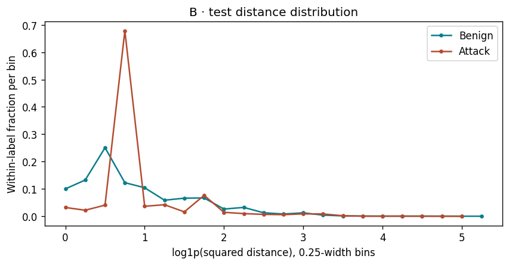


## 14. Hybrid detection

This section consolidates the accepted hybrid detection investigation. The original protocol,cohort definitions and limits remain authoritative. No experiment was rerun for this academic report.

The B and C experiments are retrospective benchmarks. The R folds use strictly earlier fit and calibration dates within the same previously examined corpus. All results below use the same retained rows within each population.

[Private Kaggle CPU notebook](https://www.kaggle.com/code/ramcharan2345/mmds-phase-8-robust-hybrid-cyberattack-detection) · [Run receipts](../manifests/phase8_experiments.json)

### Execution and eligibility

| Stage | Version | Result | Seconds | JVM peak GiB |
| --- | --- | --- | --- | --- |
| baseline-B | 1 | validated | 320.5 | 3.63 |
| baseline-C | 2 | validated | 211.7 | 3.84 |
| hybrid-B | 6 | validated | 974.7 | 4.35 |
| hybrid-C | 3 | validated | 562.5 | 4.51 |
| hybrid-R1 | 4 | validated | 1055.7 | 5.16 |
| hybrid-R2 | 5 | validated | 713.9 | 5.01 |

Both retrospective stages verified their Phase 2 receipt and reproduced the 12 Phase 4/5 validation and test comparisons per population.
[Baseline reconciliation](phase8_baseline_reconciliation.csv)

### B held-out evaluation

The operating split selected **lr_w10** as its supervised base and **or** as its fusion. Training used 795,270 grouped sample rows. Evaluation retained 71.039% of originally assigned test rows.

| Method | Precision | Recall | F1 | Binned PR-AUC | Benign FPR | Rows | Scoring time |
| --- | --- | --- | --- | --- | --- | --- | --- |
| Random Forest at 0.5 | 7.898% | 0.200% | 0.00390 | 0.60359 | 0.630% | 980,109 | 6.07s baseline pass |
| Budget-selected Random Forest | 11.000% | 0.295% | 0.00575 | 0.60359 | 0.646% | 980,109 | 6.07s baseline pass |
| Best LR (lr_w10) | 11.738% | 0.332% | 0.00646 | 0.61800 | 0.675% | 980,109 | 5.70s held out (raw base) |
| Best weighted (lr_w10) | 11.738% | 0.332% | 0.00646 | 0.61800 | 0.675% | 980,109 | 5.70s held out (raw base) |
| Calibrated supervised | NA | 0.000% | 0.00000 | 0.21276 | 0.000% | 980,109 | Shared Spark pass |
| Novelty only | 0.000% | 0.000% | 0.00000 | 0.25262 | 0.001% | 980,109 | Shared Spark pass |
| Selected fusion (or) | 0.000% | 0.000% | 0.00000 | 0.21276 | 0.001% | 980,109 | 27.28s held out |

Against calibrated supervised scoring, selected fusion changed recall by +0.000 percentage points and realized benign FPR by +0.001 points. At its frozen operating point it produced 5 false alarms per million benign flows. Triage referred 0 rows per 100,000 flows for review and automatically covered 100.000%. The frozen cutoff was 0.50000 and the validation FPR was 0.001%.

The measured base and selected-fusion scoring passes took 5.70s and 27.28s over the same 980,109 rows. These timings cover the selected methods and include Spark execution overhead.

| Probability method | Rows | Brier | Log loss | ECE |
| --- | --- | --- | --- | --- |
| raw | 980,109 | 0.22641 | 0.64261 | 0.33183 |
| platt | 980,109 | 0.19412 | 0.67926 | 0.16320 |
| isotonic | 980,109 | 0.18502 | 0.60431 | 0.15909 |

The probability-split Platt fit used a slope of +0.00472 and intercept of -2.95363 on raw-score bin midpoints. A negative slope reverses the fitted score ordering before binning.

| Attack family | Support | Seen in training | Calibrated recall | Weighted recall | Novelty recall | Fusion recall | Fusion referred or abstained |
| --- | --- | --- | --- | --- | --- | --- | --- |
| Infiltration | 65,251 | False | 0.000% | 0.449% | 0.000% | 0.000% | 0 |
| Bot | 143,274 | False | 0.000% | 0.279% | 0.000% | 0.000% | 0 |

### C held-out evaluation

The operating split selected **rf_w5** as its supervised base and **blend_0_5** as its fusion. Training used 812,520 grouped sample rows. Evaluation retained 69.533% of originally assigned test rows.

| Method | Precision | Recall | F1 | Binned PR-AUC | Benign FPR | Rows | Scoring time |
| --- | --- | --- | --- | --- | --- | --- | --- |
| Random Forest at 0.5 | 0.134% | 2.432% | 0.00253 | 0.00055 | 0.821% | 1,458,218 | 5.22s baseline pass |
| Budget-selected Random Forest | 0.228% | 2.432% | 0.00416 | 0.00055 | 0.481% | 1,458,218 | 5.22s baseline pass |
| Best LR (logistic_regression) | 0.044% | 0.152% | 0.00068 | 0.00121 | 0.157% | 1,458,218 | 4.82s baseline pass |
| Best weighted (rf_w5) | 0.031% | 3.040% | 0.00062 | 0.00088 | 4.370% | 1,458,218 | 4.43s held out (raw base) |
| Calibrated supervised | 0.000% | 0.000% | 0.00000 | 0.00038 | 0.001% | 1,458,218 | Shared Spark pass |
| Novelty only | 0.000% | 0.000% | 0.00000 | 0.00896 | 0.000% | 1,458,218 | Shared Spark pass |
| Selected fusion (blend_0_5) | 1.398% | 16.413% | 0.02577 | 0.01042 | 0.522% | 1,458,218 | 19.67s held out |

Against calibrated supervised scoring, selected fusion changed recall by +16.413 percentage points and realized benign FPR by +0.521 points. At its frozen operating point it produced 5,224 false alarms per million benign flows. Triage referred 1,868 rows per 100,000 flows for review and automatically covered 98.132%. The frozen cutoff was 0.55273 and the validation FPR was 0.977%.

The measured base and selected-fusion scoring passes took 4.43s and 19.67s over the same 1,458,218 rows. These timings cover the selected methods and include Spark execution overhead.

| Probability method | Rows | Brier | Log loss | ECE |
| --- | --- | --- | --- | --- |
| raw | 1,458,218 | 0.08241 | 0.27698 | 0.17659 |
| platt | 1,458,218 | 0.01151 | 0.11123 | 0.10378 |
| isotonic | 1,458,218 | 0.01190 | 0.11453 | 0.10689 |

The probability-split Platt fit used a slope of -0.93661 and intercept of -2.00116 on raw-score bin midpoints. A negative slope reverses the fitted score ordering before binning.

| Attack family | Support | Seen in training | Calibrated recall | Weighted recall | Novelty recall | Fusion recall | Fusion referred or abstained |
| --- | --- | --- | --- | --- | --- | --- | --- |
| Web attack | 658 | False | 0.000% | 3.040% | 0.000% | 16.413% | 260 |

### R1 held-out evaluation

The operating split selected **rf_w10** as its supervised base and **blend_0_5** as its fusion. Training used 123,543 grouped sample rows. Evaluation retained 50.393% of originally assigned test rows.

| Method | Precision | Recall | F1 | Binned PR-AUC | Benign FPR | Rows | Scoring time |
| --- | --- | --- | --- | --- | --- | --- | --- |
| Random Forest at 0.5 | 85.686% | 1.032% | 0.02039 | 0.97857 | 0.080% | 528,411 | 10.84s operating |
| Budget-selected Random Forest | 85.096% | 1.032% | 0.02039 | 0.97857 | 0.084% | 528,411 | 10.84s operating |
| Best LR (lr_w10) | 100.000% | 1.032% | 0.02043 | 0.21880 | 0.000% | 528,411 | 8.45s operating |
| Best weighted (rf_w10) | 0.000% | 0.000% | 0.00000 | 0.58979 | 0.081% | 528,411 | 3.93s held out (raw base) |
| Calibrated supervised | NA | 0.000% | 0.00000 | 0.68234 | 0.000% | 528,411 | Shared Spark pass |
| Novelty only | NA | 0.000% | 0.00000 | 0.31149 | 0.000% | 528,411 | Shared Spark pass |
| Selected fusion (blend_0_5) | NA | 0.000% | 0.00000 | 0.55277 | 0.000% | 528,411 | 13.08s held out |

Against calibrated supervised scoring, selected fusion changed recall by +0.000 percentage points and realized benign FPR by +0.000 points. At its frozen operating point it produced 0 false alarms per million benign flows. Triage referred 0 rows per 100,000 flows for review and automatically covered 100.000%. The frozen cutoff was 0.97412 and the validation FPR was 0.000%.

The measured base and selected-fusion scoring passes took 3.93s and 13.08s over the same 528,411 rows. These timings cover the selected methods and include Spark execution overhead.

| Probability method | Rows | Brier | Log loss | ECE |
| --- | --- | --- | --- | --- |
| raw | 528,411 | 0.22400 | 0.65052 | 0.12440 |
| platt | 528,411 | 0.42372 | 1.08551 | 0.54114 |
| isotonic | 528,411 | 0.25245 | 0.69804 | 0.18928 |

The probability-split Platt fit used a slope of -10.54404 and intercept of +3.14270 on raw-score bin midpoints. A negative slope reverses the fitted score ordering before binning.

| Attack family | Support | Seen in training | Calibrated recall | Weighted recall | Novelty recall | Fusion recall | Fusion referred or abstained |
| --- | --- | --- | --- | --- | --- | --- | --- |
| DDoS | 167,666 | False | 0.000% | 0.000% | 0.000% | 0.000% | 0 |

### R2 held-out evaluation

The operating split selected **lr_w1** as its supervised base and **or** as its fusion. Training used 728,118 grouped sample rows. Evaluation retained 71.384% of originally assigned test rows.

Learned fusion was skipped. The disjoint meta-training role retained 257,649 benign flows and 97 attack flows. The minimum was 100 per class.

| Method | Precision | Recall | F1 | Binned PR-AUC | Benign FPR | Rows | Scoring time |
| --- | --- | --- | --- | --- | --- | --- | --- |
| Random Forest at 0.5 | 15.549% | 1.565% | 0.02843 | 0.11397 | 1.263% | 437,632 | 1.72s operating |
| Budget-selected Random Forest | 4.822% | 0.074% | 0.00146 | 0.11397 | 0.218% | 437,632 | 1.72s operating |
| Best LR (lr_w1) | 20.573% | 2.433% | 0.04352 | 0.13373 | 1.396% | 437,632 | 4.08s held out (raw base) |
| Best weighted (lr_w5) | 21.324% | 3.088% | 0.05395 | 0.13291 | 1.694% | 437,632 | 1.23s operating |
| Calibrated supervised | NA | 0.000% | 0.00000 | 0.12940 | 0.000% | 437,632 | Shared Spark pass |
| Novelty only | 0.000% | 0.000% | 0.00000 | 0.11949 | 0.002% | 437,632 | Shared Spark pass |
| Selected fusion (or) | 0.000% | 0.000% | 0.00000 | 0.12940 | 0.002% | 437,632 | 16.52s held out |

Against calibrated supervised scoring, selected fusion changed recall by +0.000 percentage points and realized benign FPR by +0.002 points. At its frozen operating point it produced 18 false alarms per million benign flows. Triage referred 0 rows per 100,000 flows for review and automatically covered 100.000%. The frozen cutoff was 0.50000 and the validation FPR was 0.000%.

The measured base and selected-fusion scoring passes took 4.08s and 16.52s over the same 437,632 rows. These timings cover the selected methods and include Spark execution overhead.

| Probability method | Rows | Brier | Log loss | ECE |
| --- | --- | --- | --- | --- |
| raw | 437,632 | 0.11847 | 0.40858 | 0.03677 |
| platt | 437,632 | 0.12934 | 1.07656 | 0.12916 |
| isotonic | 437,632 | 0.12921 | 1.06425 | 0.12888 |

The probability-split Platt fit used a slope of -2.07818 and intercept of -7.85814 on raw-score bin midpoints. A negative slope reverses the fitted score ordering before binning.

| Attack family | Support | Seen in training | Calibrated recall | Weighted recall | Novelty recall | Fusion recall | Fusion referred or abstained |
| --- | --- | --- | --- | --- | --- | --- | --- |
| Infiltration | 56,631 | False | 0.000% | 3.088% | 0.000% | 0.000% | 0 |

### Scientific interpretation

Selected fusion did not demonstrate a recall gain without added false positives in the supported populations.
This comparison uses validation-selected thresholds. A validation FPR ceiling can differ materially from achieved held-out FPR.
The score calibration experiments use midpoint-binned probability estimates. Binned ranking metrics and capture-day comparisons do not provide row-independent uncertainty intervals. The paired disagreement table preserves same-row categorical counts.

[Probability calibration](phase8_calibration_metrics.csv) · [Family coverage](phase8_family_recall.csv) · [Operating budgets](phase8_false_positive_budgets.csv) · [Ablations](phase8_ablation_results.csv) · [Timing](phase8_performance.csv) · [Paired disagreements](phase8_paired_disagreement.csv) · [High-confidence errors](phase8_error_audit.csv) · [Inference registry](../manifests/phase8_models.json)

### Figures

- [precision recall](figures/phase8_precision_recall.png)
- [roc](figures/phase8_roc.png)
- [threshold recall](figures/phase8_threshold_recall.png)
- [threshold fpr](figures/phase8_threshold_fpr.png)
- [reliability](figures/phase8_reliability.png)
- [brier](figures/phase8_brier.png)
- [class weights](figures/phase8_class_weights.png)
- [fusion weights](figures/phase8_fusion_weights.png)
- [validation budgets](figures/phase8_validation_budgets.png)
- [family recall](figures/phase8_family_recall.png)
- [false alarms](figures/phase8_false_alarms.png)
- [risk coverage](figures/phase8_risk_coverage.png)
- [review workload](figures/phase8_review_workload.png)
- [ablation](figures/phase8_ablation.png)
- [overhead](figures/phase8_overhead.png)
- [rolling folds](figures/phase8_rolling_folds.png)


Evidence source:reports/phase8_hybrid_results.md


## 15. Multiclass and open-set classification

This section consolidates the accepted multiclass and open-set classification investigation. The original protocol,cohort definitions and limits remain authoritative. No experiment was rerun for this academic report.

### Repository and protocol

Phase 9 resumed from `f315c872f37c8ae24fa60c9e6c4ca84314f12697`
on `research-v2`, building on Phase 8 commit
`beb558748b24309b1f752b2d744614f31b1d9351`. The input audit verified
16,232,943 flows, including 2,748,235 attacks, from the checksum-pinned
Phase 2 version 1 producer. The study uses 18 frozen numerical predictors
and training-derived family IDs.

Original Phase 9 Kaggle versions 1, 2, 7, 8, 9, 10 and 11 were reused.
All 33 committed per-stage aggregate hashes matched their receipts. The
[protocol](../docs/phase9_research_protocol.md),
[methodology](../docs/phase9_multiclass_methodology.md) and
[C amendment](../docs/phase9_c_methodological_amendment.md) describe
eligibility, preprocessing, sampling and frozen thresholds.

### Grouped-random, chronological and family holdout results

| Scenario | Version | Selected model | Known evaluation attacks | Accuracy | Macro F1 |
|---|---:|---|---:|---:|---:|
| Grouped-random A | 2 | RF, capped inverse | 364,120 | 74.05% | 0.633 |
| Chronological B | 7 | LR, inverse | 0 | Undefined | Undefined |
| Web holdout | 8 | RF, capped inverse | 363,966 | 73.73% | 0.753 |
| Bot holdout | 9 | RF, capped inverse | 314,058 | 68.20% | 0.611 |
| Infiltration holdout | 10 | RF, capped inverse | 300,984 | 74.42% | 0.767 |
| DDoS holdout | 11 | LR, capped inverse | 109,434 | 76.08% | 0.697 |

The grouped-random RF improved on the majority baseline's 51.89% accuracy
and 0.114 macro F1. The analytical training-prior reference had 30.92%
accuracy and 0.162 macro F1 computed from expected confusion cells. The
frozen RF predicted zero Web attack flows among 154 true Web attacks in A.
Web precision is undefined, recall is zero and F1 is zero.

Chronological B has 208,525 attacks, all from families absent during family
training. Its closed-set accuracy, known-family recall, known-family false
rejection and known-versus-unknown ROC and PR are undefined. Rejection recall
over the unknowns remains measurable. C's earlier-only family stage also has
zero known test attacks.

[Reference baselines](phase9_reference_baselines/phase9_reference_baselines.csv)
· [Closed-set results](phase9_closed_set_metrics.csv)
· [Confusion matrices](phase9_family_confusion.csv)
· [Per-family precision and recall](phase9_per_family.csv)

### Known acceptance and unknown rejection

At the frozen maximum-score 5% known-validation budget, unknown rejection
recall was 19.53% in B, 3.45% for Web, 8.12% for Bot, 30.15% for
Infiltration and 0.0048% for DDoS. The corresponding observed known false
rejection rates in the four family holdouts were 2.77%, 1.34%, 2.83% and
7.11%. Only 61 of 1,263,933 held-out DDoS flows were rejected by maximum
uncertainty. Unknown false acceptance is the complement of unknown
rejection among the supported unknown evaluation groups.

Five scores and three known-validation budgets were evaluated with cutoff
ties retained. The validation constraint transferred unevenly to held-out
traffic. Results reported at the frozen operating points remain the
primary results. The reproduced histograms reconciled all 75 historical
operating points, including rejection, acceptance coverage and accepted
correct-family rates.

[Operating points](phase9_open_set_metrics.csv)
· [Tradeoff figure](figures/phase9_open_set_tradeoffs.png)
· [Risk–coverage, ROC and PR](figures/phase9_risk_coverage_roc_pr.png)
· [Known and unknown distributions](figures/phase9_known_unknown_score_distributions.png)
· [Per-day rates](figures/phase9_per_day_rejection.png)

### End-to-end and oracle comparisons

The chronological B hierarchy reconciled all 980,109 retained rows.
Both Phase 8 gates missed all 208,525 attacks. The Phase 4 RF passed 417
attacks to the family stage and correctly rejected 342 as UNKNOWN.
Conditional rejection was 82.01%, and full-population attack rejection was
0.164%. The oracle bypassed all binary misses, yielding 40,718 correct
UNKNOWN results (19.53%). It is a diagnostic using ground truth.

The retrospective C hierarchy reconciled all 1,458,218 retained rows.
None of the three archived gates rejected a Web attack as UNKNOWN. The
Phase 8 supervised gate missed all 658 attacks. Its hybrid passed 108
attacks and the family stage falsely accepted all 108 as known. The oracle
rejected 9 of 658 (1.37%). The predominantly benign C population makes
overall accuracy a weak measure of unknown-family performance.

The results include all benign flows, false alarms, missed attacks, correct
and incorrect complete decisions, and review burden. No end-to-end
known-family recall is reportable for B or C because neither test set
contains known attacks at the family stage.

[B hierarchy and receipt](phase9_hierarchy/B/results.md)
· [C hierarchy and receipt](phase9_hierarchy/C/results.md)
· [Attack outcome figure](figures/phase9_hierarchical_attack_outcomes.png)

### Robustness and capture-day interpretation

All five grouped-random configurations used the same 364,120 evaluation
flows. Seed 23014 reduced flow macro F1 from 0.633 to 0.563. Duplicate
training weights reduced flow macro F1 to 0.565 and increased group-weighted
macro F1 from 0.781 to 0.787. Unweighted RF improved flow accuracy while
reducing flow macro F1. The frozen grouped-random RF made 4,837
high-confidence errors at a maximum vote score of at least 0.90.
Leave-one-capture-day-out accuracy ranged from 66.87% to 83.79%.

Each attack family occurs on one or two capture days. All Bot and
credential brute-force examples each occur on a single day. Dropping
capture-day metadata from predictors does not remove capture conditions
from flow features. Rejected traffic comes from existing labeled families
in a retrospective corpus. The study provides no independent external
confirmation and correlates many flows within each capture. Descriptive
day and predictor-group comparisons replace row-independent intervals.

Under B's frozen maximum-score rule, the first test day rejected 40,680
of 65,251 unknown attacks and the second rejected 38 of 143,274. Median
registered flow duration was 39,838 µs on the first day and 10,917 µs on
the second. Median forward packet counts were two and three,
respectively. These feature and outcome contrasts coincide with a change
in evaluated family composition. B's training and test attack dates have
zero overlap. In the Web holdout, eight capture days overlap between
training and evaluation attacks overall, with the held-out family's two
days absent from known training attacks.

[Sensitivity results](phase9_sensitivity/results.md)
· [Capture-day support](figures/phase9_capture_family_support.png)
· [Evidence checklist](../docs/phase9_evidence_status.md)
· [B and Web daily evidence](phase9_open_set_evidence/15/results.md)
· [Bot, Infiltration and DDoS daily evidence](phase9_open_set_evidence/16/results.md)

### Models, execution and integration

The [classifier registry](../manifests/phase9_classifier_registry.json)
records the six original selected classifier identifiers, class mappings,
feature order, frozen rejection policies, model component hashes and
independent Spark 4.3.0 reload results. Phase 4 and Phase 8 binary and
clustering assets were checksum-verified against their original registries.
The C classifier and novelty pipeline are versioned private outputs, with
their registries linked from the C report. Versions 15 and 16 reconstructed
and persisted the five training-reference novelty pipelines used by the
original open-set scenarios. Grouped-random A is the closed-set reference.
The [novelty reload receipt](../manifests/phase9_novelty_reload.json) records
independently repeated centroid assignments and distances on synthetic
probes.

| Version | Validated stage | Worker status | Measured execution seconds | Peak driver RSS bytes |
|---|---|---|---:|---:|
| 12 | Chronological B hierarchy | COMPLETE | 299.2 | 3,753,791,488 |
| 13 | Retrospective C hierarchy and model persistence | COMPLETE | 468.7 | 4,532,752,384 |
| 14 | Grouped-random sensitivity | COMPLETE | 131.3 | 3,261,235,200 |
| 15 | B and Web open-set evidence and persistence | COMPLETE | 560.3 | 4,702,318,592 |
| 16 | Bot, Infiltration and DDoS open-set evidence and persistence | COMPLETE | 300.5 | 3,943,927,808 |

The new workers used Spark 4.3.0, four CPUs, an 8 GiB driver heap and
48 shuffle partitions. Additional resources, input counts and artifact
checksums are recorded in the [experiment manifest](../manifests/phase9_experiments.json)
and linked receipts. [Measured worker runtime and driver memory](figures/phase9_worker_resources.png)

The [inference contract](../docs/phase9_inference_contract.md) version
`phase9-hierarchy-v1` preserves Phase 8 score and abstention semantics
and defines the class probability-vector ordering and family rejection
fields. Three local synthetic B hierarchy probes reproduced the calibrated
and hybrid scores and Phase 8 abstention behavior. The isolated
[Streamlit preview](../dashboard/phase9_preview.py) reads verified aggregate
evidence. Run it locally with `streamlit run dashboard/phase9_preview.py`.

The local Spark 4.3.0 regression suite passed 76 tests, including earlier-
only C splitting, exact hierarchical reconciliation and unsupported
open-set discrimination metrics. The preview was smoke-tested with
Streamlit AppTest across all six family evaluation scenarios and both
hierarchical populations.

### Scientific conclusion and readiness

The grouped-random result shows measurable family discrimination relative to
the prespecified references, alongside marked second-seed, duplicate-weighting
and capture-day sensitivity. The archived deployment-like gates failed to
support useful unknown-family rejection in the chronological B population.
The retrospective C hierarchy yielded zero correct unknown decisions across
the three archived gates. These negative findings, the unsupported closed-set
metrics and the capture-family association are part of the validated record.

All required Phase 9 experimental stages and their compact evidence are
verified. **READY FOR PHASE 10.**


Evidence source:reports/phase9_research_report.md


## 16. Frequent and emerging pattern mining

This section consolidates the accepted frequent and emerging pattern mining investigation. The original protocol,cohort definitions and limits remain authoritative. No experiment was rerun for this academic report.

### Protocol and provenance

The phase10-v1 protocol preceded fitting. All 16,232,943 feature-ready flows were verified against the pinned Phase 2 version 1 receipt. The corpus contains 13,484,708 benign and 2,748,235 attack flows across ten captures. The 18-predictor audit creates one unique item per predictor. Primary FP-Growth uses six numerical predictors with frozen three-bin discretization.

### Mining and associations

Spark 4.3.0 executed FP-Growth over the full eligible population. Subsequent class, family and temporal enumeration sums complete signature counts. These operations use exact sufficient counts.

| Minimum support | Itemsets | Rules at confidence 0.70 | Fit and itemset summary seconds |
|---|---:|---:|---:|
| 10% | 203 | 468 | 71.97 |
| 5% | 298 | 629 | 72.26 |
| 2% | 539 | 1009 | 71.25 |
| 1% | 759 | 1428 | 70.12 |

The primary registry contains all 298 itemsets. The archived rule export contains 500 of 629 rules. Joint, antecedent and consequent counts reconstruct support, confidence, lift, leverage and conviction. Twenty canonical rules were independently verified from signature predicates. Confidence one has infinite conviction when consequent support is below one. Undefined ratios remain explicit.

### Contrast, families and temporal evolution

Class-conditioned supports and enrichment use the appropriate benign and attack denominators. All six attack families have separate support and pattern tables. Family and capture-day associations constrain causal interpretation.
- Bot has 286,191 flows and 126 eligible family patterns.
- Credential brute force has 380,949 flows and 126 eligible family patterns.
- DDoS has 1,263,933 flows and 202 eligible family patterns.
- DoS has 654,300 flows and 97 eligible family patterns.
- Infiltration has 161,934 flows and 206 eligible family patterns.
- Web attack has 928 flows and 171 eligible family patterns.

The fixed-reference analysis tracks 5,610 pattern/capture observations across 561 patterns. Categories are {'stable': 3296, 'declining': 1724, 'emerging': 278, 'disappearing': 144, 'strongly_emerging': 168}. Of these patterns, 174 exceed 5% support on at least eight captures. Categories compare each capture with the frozen reference. Zero-count disappearance and support-threshold crossings have separate definitions.

Support-weighted Jaccard complements ordinary set overlap. Capture deletion ranges describe sensitivity to the ten observed captures. Calendar gaps and fixed binary-mixture supports are recorded. Neither statistic supplies independent-flow significance.

### Chronological detection

Twenty patterns were selected using only retained training counts. Validation chose whole-score thresholds under a 1% benign FPR ceiling. The primary configuration was preserved after observing test outcomes.

| Configuration | TP | FP | FN | TN | Recall | Benign FPR | Precision |
|---|---:|---:|---:|---:|---:|---:|---:|
| Primary three bins | 0 | 0 | 208525 | 771584 | 0.0000% | 0.0000% | NA |
| Five-bin sensitivity | 461 | 4137 | 208064 | 767447 | 0.2211% | 0.5362% | 0.10026098303610265 |

Both evaluations use 980,109 retained test flows, comprising 771,584 benign and 208,525 attacks. The primary policy produced no alerts. The five-bin sensitivity produced 461 true positives and 4,137 false positives. This is a negative operational result. Its larger detection count does not establish a better acceptable detection tradeoff.

### Robustness and computational scope

Three-bin, five-bin and domain definitions and flow versus predictor-group weights have separate tables. Full-corpus group-weighted mass is approximately 10,368,838 predictor groups. Domain group weights were not exported. No claim is made for that unsupported comparison. The original full-corpus mining run took 349.41 seconds across four supports and peaked at 8.32 GiB JVM RSS. Timing scopes differ between mining, transaction preparation, rule evaluation and offline signature scoring. Per-flow deployed latency and multi-node scaling were not measured.

| Target sample | Actual flows | FP-Growth seconds | Transaction seconds | Rule seconds |
|---:|---:|---:|---:|---:|
| 1,000,000 | 996,584 | 10.75 | 135.02 | 1.84 |
| 4,000,000 | 4,071,873 | 20.76 | 105.67 | 1.42 |
| 8,000,000 | 7,979,942 | 34.45 | 110.80 | 1.20 |

### Persistence, dashboard and validation

The archived version 2 FP-Growth model was downloaded and every component matched its receipt hash. Independent reload reproduced all 298 itemsets and 629 rules. Three deterministic probes matched predictions reconstructed directly from association rules. Discretization, item vocabulary and frozen detector policies have hashed registries.

The isolated Emerging Attack Pattern Explorer provides filters, charts and downloads from compact evidence. It passed 32 support/section combinations and an empty-rule filter state. The protected public dashboard retains its original revision.

### Scientific contribution and limits

The contribution is a reproducible experiment using standard FP-Growth and exact aggregate support accounting. Frequent associations and prevalence changes cannot establish causation, concept drift or discovery of a new attack. Capture conditions, family/day confounding, discretization and duplicates materially limit interpretation. PrefixSpan is unsupported because the verified contract lacks defensible session identifiers and ordering semantics. Independent external validation remains future work.

### Execution and final validation

Kaggle versions 1, 2, 3 and 4 completed discretization, full-corpus mining, exact signature aggregation and bounded CPU benchmarks, respectively. Their retrieved logs contain the expected terminal markers. All 77 research regression tests and eight dashboard regression tests passed. The preview passed 32 support/section combinations, six family filters, six temporal-category choices and the empty-rule state. Tables, figures and source hashes are indexed in manifests/phase10_experiments.json.


Evidence source:reports/phase10_results.md


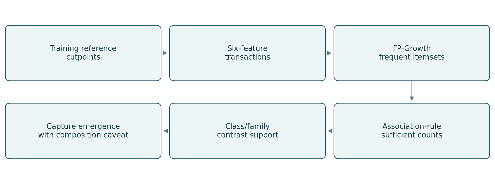


## 17. Historical streaming and drift detection

This section consolidates the accepted historical streaming and drift detection investigation. The original protocol,cohort definitions and limits remain authoritative. No experiment was rerun for this academic report.

### Input, replay and recovery

The Phase 2 receipt covers 16,232,943 original flows and 14 timestamp anomalies. The overlap purge removed 909,956 rows. Spark processed 15,322,987 retained flows in 49 replay microbatches. 14 retained anomaly rows contribute only to their capture day. The saved Phase 4 and Phase 5 B pipelines and their original preprocessing passed hash and synthetic scoring checks. The direct version-qualified preflight could not locate Phase 4 B. The completed notebook mounted a byte-verified private mirror of the exact version 2 files. [Private model mirror](https://www.kaggle.com/code/ramcharan2345/mmds-phase-6-pinned-chronological-models)

The query used available-now and a one-file trigger. A planned failure at batch 1 left its atomic aggregate intact and its Spark checkpoint uncommitted. Restart reused the query ID with a new run ID, replayed batch 1 without rewriting its aggregate, ignored a partial sink file, and matched the complete batch and checkpoint ranges. [Spark progress](../manifests/phase6_stream_progress.json) · [Recovery evidence](phase6_recovery_tests.csv)

### Frozen later-capture performance

| Model | TP | TN | FP | FN | Precision | Recall | F1 | PR-AUC |
| --- | --- | --- | --- | --- | --- | --- | --- | --- |
| random_forest | 417 | 766,721 | 4,863 | 208,108 | 7.8977% | 0.2000% | 0.00390 | 0.603592 |
| logistic_regression | 177 | 771,533 | 51 | 208,348 | 77.6316% | 0.0849% | 0.00170 | 0.623175 |
| duration_rule | 172,571 | 559,001 | 212,583 | 35,954 | 44.8057% | 82.7579% | 0.58136 | 0.407487 |

At the saved P99 distance of 16.679406, K-Means flagged 21,042 test flows, including 4,437 attack-labeled and 16,605 benign-labeled flows. Attack recall was 2.1278% and benign false-positive rate was 2.1521%. The unlabelled flag rate was 2.1469%, compared with 1.0023% in training. [Window metrics](phase6_window_metrics.csv)

### Alert and performance evidence

| Alert category | Warning | High |
| --- | --- | --- |
| INPUT_SHIFT | 15 | 0 |
| SCORE_SHIFT | 4 | 44 |
| CLUSTER_SHIFT | 10 | 0 |
| NOVELTY_RATE | 11 | 2 |
| PERFORMANCE_WARNING | 0 | 16 |

[Alert records](phase6_alerts.csv) · [Shift measures](phase6_shift_metrics.csv) · [Interpretation](../docs/phase6_drift_interpretation.md)

| Configuration | Files per trigger | Batches | Rows | Elapsed (s) | Rows/s | Checkpoint bytes |
| --- | --- | --- | --- | --- | --- | --- |
| historical | 1 | 49 | 15,322,987 | 862.32 | 17,770 | 78,005 |
| comparison-1 | 1 | 4 | 944,675 | 63.02 | 14,991 | 5,529 |
| comparison-2 | 2 | 2 | 944,675 | 47.84 | 19,746 | 3,037 |

Staging used 1,715,782,027 bytes and took 397.69 seconds. The Spark JVM peaked at 9.38 GiB RSS. The historical query recorded 3.107 seconds in Spark's offset and commit timing counters. Each comparison used the same four chunks on the same local CPU session with a separate checkpoint. [Batch timings](phase6_replay_batches.csv) · [Performance metrics](phase6_performance.csv)

### Figures

- [Timeline](figures/phase6_timeline.png)
- [Batch rows](figures/phase6_batch_rows.png)
- [Batch latency](figures/phase6_batch_latency.png)
- [Predicted attack](figures/phase6_predicted_attack.png)
- [Novelty](figures/phase6_novelty.png)
- [Occupancy](figures/phase6_occupancy.png)
- [Cluster shift](figures/phase6_cluster_shift.png)
- [Input shift](figures/phase6_input_shift.png)
- [Score shift](figures/phase6_score_shift.png)
- [Alerts](figures/phase6_alerts.png)
- [Performance](figures/phase6_performance.png)


Evidence source:reports/phase6_streaming_results.md


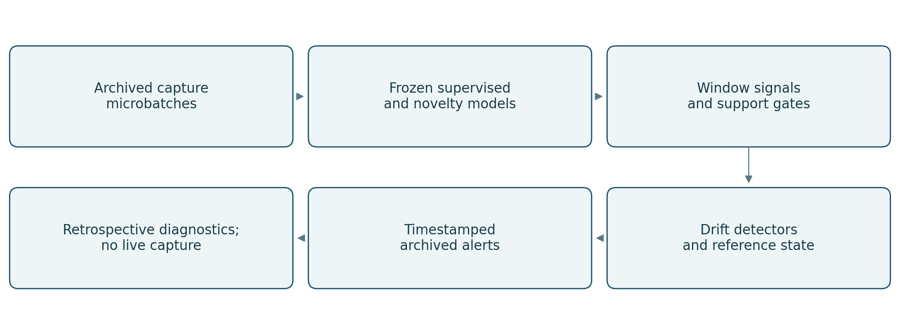


## 18. Advanced drift-monitoring evidence

This section consolidates the accepted advanced drift-monitoring evidence investigation. The original protocol,cohort definitions and limits remain authoritative. No experiment was rerun for this academic report.

### Objectives and protocol

This study compares controlled synthetic change detection with retrospective monitoring of previously examined network captures. The original phase11-v1 protocol and primary results are preserved. The finalization sensitivity plan was committed before its supplemental experiments. Historical distribution changes have no authoritative concept-drift labels.

### Data and signal provenance

The verified Phase 6 Spark evidence represents 15,322,987 retained flows in 49 batches. Four batches have fewer than 100 flows: two capture-only anomaly batches with five and nine flows, and two ordinary intraday batches with 50 and 53. The default historical monitor updates on 45 supported windows. The evaluation subset has 36 supported windows, with attack-dependent metrics absent on some windows. Eighteen primary predictors remain unchanged. No raw dataset was downloaded for this finalization.

### Implementation and experimental populations

River 0.22.0 supplies ADWIN, Page-Hinkley, KSWIN and binary DDM. JS uses base-two logarithms and PSI natural logarithms, with 1e-6 count smoothing. Synthetic reference bins and thresholds use independent calibration seeds. Synthetic evaluation uses seeds 23013–23015, 4096 arrivals and a primary warm-up of 256. DDM targets released binary-error episodes. Other detectors target the observed feature signal, including explicit missingness or prior signals where declared. Native reset semantics remain intact unless the supplemental external-reset policy explicitly reconstructs a detector.

### Synthetic effectiveness and stationary alarms

| Detector | Target episodes | Detected | Missed | Stationary false alarms / 11,520 eligible arrivals | Mean detected delay in arrivals |
|---|---:|---:|---:|---:|---:|
| ADWIN | 27 | 24 | 3 | 0 | 152.14 |
| PageHinkley | 27 | 18 | 9 | 0 | 119.57 |
| KSWIN | 27 | 17 | 10 | 7 | 76.43 |
| DDM | 6 | 6 | 0 | 1 | 26.00 |
| JS | 27 | 24 | 3 | 1 | 129.67 |
| PSI | 27 | 24 | 3 | 3 | 153.43 |
| FixedJS | 27 | 24 | 3 | 0 | 140.33 |

The mean delay averages detected stream/episode summaries and is undefined when no episode is detected. The table uses zero simulated label delay. DDM has a different target set and cannot be ranked directly against feature detectors by this average. KSWIN detects abrupt shifts quickly but produces more stationary alarms than ADWIN or Page-Hinkley. No detector consistently dominates across target mechanisms, missingness policies and cost. Positive shifts in the controlled feature-label relationship are synthetic concept experiments and provide no independent real-traffic confirmation.

### Label timing and historical monitoring

DDM consumes binary errors only after their simulated release at zero, one or three 64-arrival windows. Historical aggregate-error updates respect the analogous replay-window clock. Unreleased labels at stream end remain pending. Historical binary DDM is unsupported because original within-window error order was not saved. Historical KSWIN cannot satisfy its fixed 100-observation warm-up within 49 windows. These are documented methodological limitations, not successful no-drift outcomes.

### Reference and warm-up sensitivity

The supplemental grid contains 162 comparisons across reference lengths or reporting warm-ups of 64, 256 and 512. JS/PSI change their independently calibrated reference. Adaptive methods retain native updates and vary reporting eligibility, including KSWIN’s minimum of 100. This adaptive comparison changes excluded warm-up support, not the internal algorithm. Eligible-arrival denominators are 4096 minus effective warm-up. Repeated alerts within a 512-arrival event horizon are separate from matched detections and excess alerts.

### Reset sensitivity

Native continuation and explicit external reset each detected 21 of 24 recurring episodes across detector/seed combinations and produced nine excess alerts. Explicit reset performed 36 external reconstructions. Native continuation performs no additional reset. Cooldown preserved 21 detected episodes and suppressed one raw alert; all native state updates continued. Thus suppression and resetting are distinct operations. DDM may miss error-rate decreases, consistent with its error-increase orientation.

### Missing-input sensitivity

There are 132 comparisons over random missingness, a consecutive burst, post-change missingness and nonfinite arrivals. Skip and reference-median policies detected all 36 feature targets in their respective grids. Histogram support suppression missed six of 24 targets. The indicator policy targets missingness transitions and missed three of 27 targets. These denominators describe different signals. Delay is in original arrival observations; valid-observation delay and effective update counts are separate columns. No invalid input is silently replaced by zero. Unavailable update results remain distinct from negative alerts.

Under the prespecified 512-arrival event horizon, skip generated 18 excess alerts and reference-median imputation 22. The missingness-indicator grid generated two excess alerts over its distinct targets. Histogram support handling generated 445 excess alerts while detecting 18 of 24 targets. Fixed-reference breaches can persist after a change; this event metric records their continuing alert workload. The separate stationary experiments provide the no-change false-alarm benchmark.

### Minimum-support sensitivity

RF and cluster histogram eligibility changes from 49 windows at minimum support one to 45 at 100, 44 at 1000 and 43 at 10000. Saved feature-JS, released error support, capture-level pattern support and family-label support have separate records and units. Zero-support family strata remain unavailable. Suppressed windows have null alert fields. No historical false-alarm rate is inferred without event truth.

### Detector agreement

There are 495 matched synthetic pair/scenario/seed comparisons plus seven compatible historical comparisons. Synthetic pairs use 60 post-warm-up intervals of 64 arrivals. DDM is excluded from feature-signal agreement because it observes a different signal. Exact-interval agreement is distinct from one-to-one positive matches within one interval. Historical comparisons retain only mutually supported windows after native warm-up. JS and PSI share one positive and 35 negative historical histogram intervals, yielding Jaccard and kappa one in that narrow comparison. ADWIN/Page-Hinkley comparisons have 16 supported score-mean intervals and 16, 15 or 13 released-error intervals depending on label delay; all-zero Jaccard and kappa remain undefined. Agreement alone does not establish correctness.

### Association with observed performance

The 144 association summaries cover JS/PSI and eight RF outcome measures at lags zero, one and three, with three label-release assumptions. The paired table records source, outcome, release and analysis clocks. At contemporaneous immediate-label settings, JS/error Pearson is 0.0219 and PSI/error Pearson 0.0232 over 36 paired windows. For recall, Pearson values are 0.4606 and 0.2345 over 22 pairs, while rank associations are 0.0695 and −0.1679. Magnitude and direction depend on the metric and estimator. Row-weighted correlations and one-window before/after changes are descriptive. Capture gaps, changing prevalence, rare-family support and temporal dependence prevent causal or reliable future-failure claims. Family-specific window recall is unsupported by the saved aggregate schema.

### Ensembles, costs and recovery

The existing 66 ensemble/control ablations and 36 window/magnitude sensitivity records remain preserved. The ensemble is fixed at two detector families within 64 arrivals with cooldown. It is not selected on final outcomes. Initialization, update, snapshot and restore times and serialized state bytes are measured in 36 supplemental cost records. Process RSS is a cumulative process high-water mark, not isolated detector allocation. Historical costs are per supported aggregate window. No claim is made that advanced detectors individually processed all retained flows, or that single-node measurements demonstrate multi-node scalability. Four detector states passed trusted snapshot/reload and duplicate-batch checks.

### Dashboard and scientific contribution

The isolated Drift Detection Laboratory presents primary evidence and the supplemental grids, agreement, associations, costs and limitations. All downloads use filtered aggregate tables. The contribution is a reproducible monitoring comparison and explicit information-availability accounting using established detectors. Shift alerts are evidence to investigate, not confirmation of attacks or proof that adaptation will improve outcomes. Phase 12 has not started and requires separate user authorization.

### Reproducibility and limitations

Reuse Kaggle notebook versions 1 and 2 and their hashed receipts. Run `PYTHONPATH=. python -c "from src.drift.finalization import run; run('/tmp/phase11-finalization')"` with the pinned River dependency to reproduce the bounded supplemental experiments. The original protocol, finalization plan, method definitions and registry describe frozen choices and unsupported cases. Regenerate final figures and this report with `python scripts/finalize_phase11_report.py`. Timings vary by host. Synthetic evidence, retrospective historical associations and future independent validation remain separate. The completed experiment manifest records the final gate, test results, hashes and protected-reference verification.

### State clocks, runtime compatibility and browser checks

The state adapter distinguishes arrivals, valid updates and suppressed updates, restores state after a failed batch, and leaves missing counters unknown in legacy snapshots. Additional engineering probes measure duplicate checks, snapshot/restore and alert-metadata construction separately from detector updates. The isolated preview runtime uses Starlette 0.49.3 with Streamlit 1.67.0 to avoid the observed Starlette 1.10.0 static-file failure. Browser evidence includes desktop and mobile screenshots, no HTTP or page errors, and actual 297-record downloads. Reference-score history includes retrospective scoring of the archived RF training population and supports no prospective deployment claim.

### Final validation

The complete regression run passed 101 research tests and 8 dashboard tests. Preview validation covered 2024 supported filter groups and 21 sections. No Phase 12 implementation was started.


Evidence source:reports/phase11_results.md


## 19. Adaptive learning

This section consolidates the accepted adaptive learning investigation. The original protocol,cohort definitions and limits remain authoritative. No experiment was rerun for this academic report.

### Starting checkpoint and environment

Phase 12 started on research-v2 at `96c1885ef97243e4de33757603fe1530994f0f8e`. Stage 12F resumed from `ccb6de944ae41b3c1210e1b2b1808db6e4e111c3` after account recovery. Historical fitting/scoring used private Kaggle CPU, Spark 4.3.0, local[4], 8 GiB driver and48 shuffle partitions. Local CPU handled controlled synthetic experiments, tests and the isolated preview. No full raw dataset was downloaded.

### Phase 11 acceptance

The original Phase 11 acceptance validator passed before Phase 12 began, with15 tables,24 figures and109 regression tests. Its frozen receipts and detector registry remain unchanged.

### Frozen protocol and amendments

Protocol commit3ff45ef precedes all new fitting. configs/phase12_adaptation.yaml defines every primary operating point and budget. docs/phase12_protocol_amendments.md documents correction of the inherited capture-only timestamp policy before replacement-primary fitting. No predictive hyperparameters or alert thresholds were selected from Phase 12 outcomes.

### Evaluation populations

Original late-period B retains13,191,622 training,1,151,256 validation and980,109 test flows. Archived Phase 8 independently reproduced its static scores. Primary E assigns permanent70/15/15 fitting/calibration/evaluation predictor-group roles over16,232,943 verified flows, including14 flagged observations at trusted capture-day resolution. Fitting uses a deterministic125/10000 sample of fitting predictor groups; calibration and forward evaluation use their full assigned roles. Initial fitting is February14–15, calibration February16, and forward captures February20,21,22,23,28 and March1,2. The primary matched forward evaluation has1,997,636 rows. The16,232,929-row stricter sensitivity stays separate. Synthetic data use six known mechanisms,48×512 observations,18 predictors, three seeds and 42 forward windows per run.

### Leakage and label availability

Exact-record, canonical-feature and predictor-group cross-role audits are zero. Imputed-vector collisions are reported diagnostically for every fitted candidate. Training-only median imputation, feature filtering and scaling remain separate from promotion and evaluation. Every prediction is issued before release/update. Delays 0, 1, 3 retain pending labels at replay end, without flushing. Eventual-label all-issued metrics support matched retrospective comparisons; released-only endpoint metrics are separate. Archived bin/family/version counts exactly reconstruct configured operating decisions; raw row predictions were materialized in private runtime scratch and are not durable outputs.

### Initial static performance

P0 produced 463 TP and 4,691 FP, recall 0.183%, precision 8.983%, FPR 0.269% and PR-AUC 0.1590. All primary policies/delays reuse the exact saved initial pipeline and threshold. The original late B benchmark has a different population and remains in its own table.

### Primary historical E, LR, delay0, candidate cap3

| Policy | Population | TP | FP | Recall | Precision | F1 | Benign FPR | PR-AUC | Requests | Accepted | Build cost, s |
|---|---|---:|---:|---:|---:|---:|---:|---:|---:|---:|---:|
| P0 | historical E | 463 | 4,691 | 0.183% | 8.983% | 0.358% | 0.269% | 0.1590 | 0 | 0 | 0.000 |
| P1 | historical E | 463 | 8,641 | 0.183% | 5.086% | 0.353% | 0.495% | 0.1695 | 3 | 3 | 108.277 |
| P2 | historical E | 634 | 9,835 | 0.250% | 6.056% | 0.481% | 0.564% | 0.1920 | 1 | 1 | 36.507 |
| P3 | historical E | 601 | 5,631 | 0.237% | 9.644% | 0.463% | 0.323% | 0.1590 | 0 | 0 | 0.000 |
| P4 | historical E | 648 | 9,548 | 0.256% | 6.355% | 0.492% | 0.547% | 0.1561 | 3 | 2 | 56.347 |
| P5 | historical E | 548 | 18,087 | 0.216% | 2.941% | 0.403% | 1.037% | 0.2209 | 3 | 3 | 101.181 |
| P6 | historical E | 463 | 4,691 | 0.183% | 8.983% | 0.358% | 0.269% | 0.1590 | 1 | 0 | 36.507 |

### Archived late-period B, fixed original operating points

These reused benchmarks incur zero new Phase 12 fitting cost. Original fitting times remain in reports/phase4_metrics.csv.

| Policy | Population | TP | FP | Recall | Precision | F1 | Benign FPR | PR-AUC | Requests | Accepted | Build cost, s |
|---|---|---:|---:|---:|---:|---:|---:|---:|---:|---:|---:|
| archived majority | archived B test | 0 | 0 | 0.000% | undefined | 0.000% | 0.000% | 0.2128 | 0 | 0 | 0.000 |
| archived duration_rule | archived B test | 172,571 | 212,583 | 82.758% | 44.806% | 58.136% | 27.552% | 0.4075 | 0 | 0 | 0.000 |
| archived logistic_regression | archived B test | 177 | 51 | 0.085% | 77.632% | 0.170% | 0.007% | 0.6232 | 0 | 0 | 0.000 |
| archived random_forest | archived B test | 417 | 4,863 | 0.200% | 7.898% | 0.390% | 0.630% | 0.6036 | 0 | 0 | 0.000 |
| archived gradient_boosted_trees | archived B test | 1,218 | 7,021 | 0.584% | 14.783% | 1.124% | 0.910% | 0.2188 | 0 | 0 | 0.000 |
| archived logistic_regression | archived B test | 787 | 91 | 0.377% | 89.636% | 0.752% | 0.012% | 0.6496 | 0 | 0 | 0.000 |

### Periodic retraining

P1 accepted 3 candidates after 3 requests. It yielded 463 TP and 8641 FP. Compare its integer-count tradeoff with P0; accepting a valid refresh does not establish useful adaptation.

### Drift-triggered refresh

P2 executed the frozen .1 JS input-distribution policy with 1 alerts and 1 fitting requests. End-of-replay, support and cooldown suppressions are explicit. An alert without a future activation opportunity cannot improve issued predictions. The trigger is independent of evolving model scores.

### Adaptive threshold

P3 changed the operating threshold 6 times using released, separate calibration labels and frozen coefficients. Its resulting recall is 0.237% and FPR 0.323%. The 1% ceiling applies to eligible validation benign observations, not an assured future FPR. The no-positive threshold remains permissible.

### Sliding and expanding windows

P4 used the latest 2 released fitting captures, with 648 TP,9548 FP and 2 accepted candidates. P1 expands every 2 captures; P5 requests expanding refresh every capture subject to the same cooldown/cap. P5 yielded 548 TP and 18087 FP. Sliding3 and other bounded sensitivities are in phase12_robustness.csv.

### Guarded promotion

P6 made 1 requests and accepted 0 candidates in the primary historical run. The historical opportunity count limits any guard efficacy conclusion. Synthetic guard comparisons and focused tests exercise actual acceptance/rejection. Guard rules compare candidate and incumbent on the same released calibration rows, plus separate fixed retention diagnostics.

### Compute budgets

The primary comparison shares a maximum 3 requests, model family, deterministic fitting sample, validation requirements and evaluation cohort. Cap 6 natural-policy P1/P2 sensitivity is separately reported. Equal caps do not imply equal realized rows, requests or cost. Identical saved candidates are reused when histories match, with original build duration charged counterfactually. Physical work is counted once. Ratios with zero/nonpositive detection benefit remain undefined.

### Label-delay sensitivity

All seven LR policies were executed at delays 0, 1, 3 on the same forward cohort. Pending last-delay windows remain unavailable for adaptation. phase12_label_delay.csv and phase12_released_only_metrics.csv distinguish eventual-label evaluation from labels released by termination. Delayed-label and calendar-gap clocks are simulation assumptions, not observed analyst turnaround times.

### Controlled synthetic recovery

The 288 controlled runs cover stationary, feature-only distribution shift, prior shift, abrupt/gradual conditional reversal and recurring concepts over seeds23013/14/15. Local sklearn LR uses C=20, max_iter=200; it is a separate implementation from historical Spark LR. JS cannot generally detect a conditional change that leaves inputs stationary. Periodic adaptation can recover recall while worsening false alarms; guard retention can reject useful new-concept fitting. Recovery is the first postchange three-window block with pooled recall reaching prechange recall minus.05. Full seed/delay outcomes and undefined recovery are retained.

### Synthetic stationary, seed23013, delay0

| Policy | Population | TP | FP | Recall | Precision | F1 | Benign FPR | PR-AUC | Requests | Accepted | Build cost, s |
|---|---|---:|---:|---:|---:|---:|---:|---:|---:|---:|---:|
| P0 | synthetic stationary | 99 | 3 | 5.861% | 97.059% | 11.055% | 0.179% | 0.8582 | 0 | 0 | 0.000 |
| P1 | synthetic stationary | 234 | 6 | 13.854% | 97.500% | 24.261% | 0.357% | 0.8633 | 5 | 5 | 0.021 |
| P2 | synthetic stationary | 99 | 3 | 5.861% | 97.059% | 11.055% | 0.179% | 0.8582 | 0 | 0 | 0.000 |
| P3 | synthetic stationary | 195 | 10 | 11.545% | 95.122% | 20.591% | 0.595% | 0.8582 | 0 | 0 | 0.000 |
| P6 | synthetic stationary | 99 | 3 | 5.861% | 97.059% | 11.055% | 0.179% | 0.8582 | 0 | 0 | 0.000 |

### Synthetic feature-shift, seed23013, delay0

| Policy | Population | TP | FP | Recall | Precision | F1 | Benign FPR | PR-AUC | Requests | Accepted | Build cost, s |
|---|---|---:|---:|---:|---:|---:|---:|---:|---:|---:|---:|
| P0 | synthetic feature-shift | 1,102 | 10 | 45.164% | 99.101% | 62.050% | 1.255% | 0.9707 | 0 | 0 | 0.000 |
| P1 | synthetic feature-shift | 911 | 10 | 37.336% | 98.914% | 54.210% | 1.255% | 0.9704 | 5 | 3 | 0.020 |
| P2 | synthetic feature-shift | 762 | 5 | 31.230% | 99.348% | 47.521% | 0.627% | 0.9702 | 6 | 5 | 0.023 |
| P3 | synthetic feature-shift | 1,037 | 14 | 42.500% | 98.668% | 59.410% | 1.757% | 0.9707 | 0 | 0 | 0.000 |
| P6 | synthetic feature-shift | 1,102 | 10 | 45.164% | 99.101% | 62.050% | 1.255% | 0.9707 | 6 | 0 | 0.023 |

### Synthetic prior-shift, seed23013, delay0

| Policy | Population | TP | FP | Recall | Precision | F1 | Benign FPR | PR-AUC | Requests | Accepted | Build cost, s |
|---|---|---:|---:|---:|---:|---:|---:|---:|---:|---:|---:|
| P0 | synthetic prior-shift | 290 | 6 | 17.618% | 97.973% | 29.866% | 0.373% | 0.9205 | 0 | 0 | 0.000 |
| P1 | synthetic prior-shift | 683 | 24 | 41.495% | 96.605% | 58.054% | 1.493% | 0.9274 | 5 | 5 | 0.021 |
| P2 | synthetic prior-shift | 384 | 7 | 23.329% | 98.210% | 37.703% | 0.435% | 0.9360 | 6 | 6 | 0.026 |
| P3 | synthetic prior-shift | 580 | 18 | 35.237% | 96.990% | 51.693% | 1.119% | 0.9205 | 0 | 0 | 0.000 |
| P6 | synthetic prior-shift | 372 | 8 | 22.600% | 97.895% | 36.723% | 0.498% | 0.9251 | 6 | 1 | 0.026 |

### Synthetic abrupt-conditional, seed23013, delay0

| Policy | Population | TP | FP | Recall | Precision | F1 | Benign FPR | PR-AUC | Requests | Accepted | Build cost, s |
|---|---|---:|---:|---:|---:|---:|---:|---:|---:|---:|---:|
| P0 | synthetic abrupt-conditional | 35 | 67 | 2.073% | 34.314% | 3.911% | 3.986% | 0.4407 | 0 | 0 | 0.000 |
| P1 | synthetic abrupt-conditional | 235 | 90 | 13.922% | 72.308% | 23.348% | 5.354% | 0.7058 | 5 | 5 | 0.020 |
| P2 | synthetic abrupt-conditional | 35 | 67 | 2.073% | 34.314% | 3.911% | 3.986% | 0.4407 | 0 | 0 | 0.000 |
| P3 | synthetic abrupt-conditional | 73 | 11 | 4.325% | 86.905% | 8.239% | 0.654% | 0.4407 | 0 | 0 | 0.000 |
| P6 | synthetic abrupt-conditional | 35 | 67 | 2.073% | 34.314% | 3.911% | 3.986% | 0.4407 | 0 | 0 | 0.000 |

### Synthetic gradual-conditional, seed23013, delay0

| Policy | Population | TP | FP | Recall | Precision | F1 | Benign FPR | PR-AUC | Requests | Accepted | Build cost, s |
|---|---|---:|---:|---:|---:|---:|---:|---:|---:|---:|---:|
| P0 | synthetic gradual-conditional | 50 | 52 | 3.010% | 49.020% | 5.672% | 3.044% | 0.5194 | 0 | 0 | 0.000 |
| P1 | synthetic gradual-conditional | 240 | 29 | 14.449% | 89.219% | 24.870% | 1.698% | 0.7450 | 5 | 5 | 0.024 |
| P2 | synthetic gradual-conditional | 50 | 52 | 3.010% | 49.020% | 5.672% | 3.044% | 0.5194 | 0 | 0 | 0.000 |
| P3 | synthetic gradual-conditional | 87 | 4 | 5.238% | 95.604% | 9.932% | 0.234% | 0.5194 | 0 | 0 | 0.000 |
| P6 | synthetic gradual-conditional | 50 | 52 | 3.010% | 49.020% | 5.672% | 3.044% | 0.5194 | 0 | 0 | 0.000 |

### Synthetic recurring, seed23013, delay0

| Policy | Population | TP | FP | Recall | Precision | F1 | Benign FPR | PR-AUC | Requests | Accepted | Build cost, s |
|---|---|---:|---:|---:|---:|---:|---:|---:|---:|---:|---:|
| P0 | synthetic recurring | 62 | 40 | 3.671% | 60.784% | 6.924% | 2.381% | 0.5908 | 0 | 0 | 0.000 |
| P1 | synthetic recurring | 109 | 109 | 6.454% | 50.000% | 11.432% | 6.488% | 0.5734 | 5 | 5 | 0.022 |
| P2 | synthetic recurring | 62 | 40 | 3.671% | 60.784% | 6.924% | 2.381% | 0.5908 | 0 | 0 | 0.000 |
| P3 | synthetic recurring | 116 | 12 | 6.868% | 90.625% | 12.768% | 0.714% | 0.5908 | 0 | 0 | 0.000 |
| P6 | synthetic recurring | 62 | 40 | 3.671% | 60.784% | 6.924% | 2.381% | 0.5908 | 0 | 0 | 0.000 |

### Families and forgetting

Family/window/version counts cover DDoS,DoS,credential brute force,Bot,Infiltration and Web attacks. Initial/newly released fitting support, first exposure, active versions and forward misses are explicit. Fixed retention rows are separate from forward evaluation. Capture day and attack family are strongly confounded. A family with no later post-exposure evaluation cannot support a forward-learning claim. No row-independent confidence intervals or established-superiority claim is made.

### Candidate outcomes

Across accepted historical execution scopes, 52 logical fitting requests and 48 acceptance decisions are reported. A trained model can still fail validation support or guard criteria. Fitting success, action failure, rejection and actual future activation are separate fields. Rejected candidates never replace the incumbent.

### Registry and versioning

The compact registry indexes 33 unique saved historical pipelines, with source commits, feature order, training days/classes/families, hyperparameters, preprocessing, hashes, private archive locations and reload receipts. Run-specific lifecycle tables contain parent, operating thresholds, calibration populations, decisions and served windows. The final controller atomically persists model and operating threshold together; interrupted updates preserve the previous pointer. Completed replay receipts are idempotent.

### Rollback and failure recovery

Controlled tests exercise twelve failure/recovery cases, including corrupt files, failed reload, schema mismatch, missing classes/labels, failed fitting/write, nonfinite scores, duplicate requests, interrupted promotion and actual saved-model restoration. Fresh-process Spark verification additionally restores a retrieved pipeline and checks its probes. Injected events are labeled separately. Natural historical rollback totals remain their observed values in the policy table, including zero.

### Computational overhead

Accepted historical artifacts required 33 unique physical model builds, totaling 1117.972 measured build seconds, including 108.598 optimizer seconds. Build timing includes training-only preprocessing, validation safeguards, persistence/reload and imputed-overlap audits. Per-policy charged work is counterfactual and must not be summed as actual physical compute. Physical scoring tables include Parquet materialization and histogram IO; cache-hit call latency is not production inference throughput. Distribution construction, scalar JS/detector work, registry updates, peak driver RSS, model bytes, rejected runs and total notebook runtime have separately scoped receipts. CPU consumption and multi-node scalability were not measured.

### Saved models and independent reload

All historical model components are SHA256-verified after Kaggle output retrieval. Fresh local Spark processes reopen retrieved saved pipelines and compare deterministic probes, including controlled Spark rollback. Later Kaggle runtimes reload the exact frozen initial pipeline and reproduce its archived calibration histogram. A separate fresh process reloaded all 344 synthetic models and matched their registered probes. Fitted weights remain outside Git.

### Kaggle execution receipts

Accepted primary stages are:

- 12C: `ramcharan2345/mmds-phase-12-adaptive-learning-model-refresh/3` · COMPLETE · 4 runs · 9 verified model artifacts
- 12D: `ramcharan2345/mmds-phase12-12d-adaptive-research/1` · COMPLETE · 5 runs · 4 verified model artifacts
- 12E: `ramcharan2345/mmds-phase-12-robustness-completion/1` · COMPLETE · 26 runs · 29 verified model artifacts

Primary notebook versions1 and2 remain documented as rejected-engineering and separate stricter sensitivity, respectively. Submitted/running states are never called completed. The first Stage12E worker stopped with an RF vector-validation error after fourteen completed LR scopes. The final robustness worker restores those verified scopes and executes the twelve remaining profiles; source-specific ERROR and COMPLETE receipts are retained.

### Figures and isolated dashboard

13 reproducible multi-panel figures cover architecture/clocks, policy metrics, active versions, thresholds, delays, families, retention, budgets, synthetic mechanisms, ablations, injected recovery and overhead. Preview status is PASS. The browser receipt enumerates actual sections, filters, CSV downloads, charts, console/network results and desktop/mobile screenshots. The public dashboard was not modified or deployed.

### Regression results

Complete regression receipt: `{"command": "python -m unittest discover -s tests -v", "errors": 0, "evidence_frozen_during_run": true, "failures": 0, "log_sha256": "967993a0c4bf089ca4547dd53f074737cf7b7fe370d0583c629cc6d7f49dcdc6", "original_tests": 109, "passed": 135, "python": "3.12.14", "seconds": 146.388, "skipped": 0, "spark": "4.3.0", "starting_tests": 135, "status": "PASS", "total": 135}`. All original 109 tests remain intact. New tests enforce information boundaries, source coverage, role typing, atomic model/threshold recovery, serialization, real rollback, idempotency, synthetic definitions and artifact reconciliation.

### GitHub verification

Every successful stage is committed and pushed to origin/research-v2, followed by independent ls-remote verification. Final remote SHA is reported in the final task response and final validation receipt. Protected work/main and the baseline tag must match their starting values. No force push or merge is performed.

### Conclusions and limitations

Adaptation is not assumed beneficial. Small seven-capture historical support, family/day confounding, correlated/repeated predictor groups, retrospective reuse, simulated labels and cross-version score comparability limit interpretation. Input drift does not establish concept drift or forecast model failure. Synthetic improvements establish controlled behavior only. Guarded retention can impede new-concept adaptation. Scientific unsupported comparisons are listed explicitly; engineering defects are corrected and their execution receipts retained.


READY FOR PHASE 13. Supported experimental scopes, independent histogram metrics, model reloads, figures, preview/browser checks, full regression and protected-reference checks passed. The final response identifies the independently verified remote checkpoint. Phase 13 awaits separate authorization.


Evidence source:reports/phase12_results.md


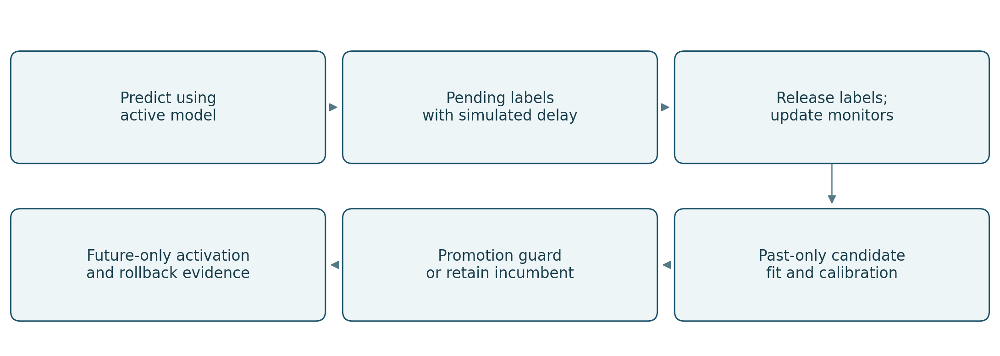


## 20. Explainable AI

This section consolidates the accepted explainable ai investigation. The original protocol,cohort definitions and limits remain authoritative. No experiment was rerun for this academic report.

### Outcome and scope

Phase 13 completed four private Kaggle CPU stages, exact archived-model reconstruction, matched permutation, chronological/failure analysis, adaptive comparisons, figures and the isolated laboratory. The independent acceptance receipt is PASS. No Phase 14 work or public deployment was performed. All interpretation is model behavior and association rather than causation.

### Starting checkpoint and protected state

The phase started at `be53a63b7f8f330c3561efcdf73f2501d66ccac7` on research-v2. Main, work and the validated-baseline tag retain their original hashes, independently checked by the completion validator. The original 135 tests remain intact.

### Prespecification and execution

Protocol commit `98e18753783665fd9b3a0805a623047d3af01ede` preceded historical explanation scoring. Notebook `ramcharan2345/mmds-phase-13-explainable-ai` versions1–4 all completed and have version-pinned output hashes and terminal-log receipts. Stage1 conditional metadata strata are superseded by the deterministic representative correction, documented before their acceptance. Stage1 numerical/global results remain valid.

### Model selection and leakage control

Six Phase 4 A/B group-sample LR/RF/GBT pipelines and ten novelty/hybrid/family/adaptive pipeline references were loaded from original versioned archives and hash checked. The selected adaptive P1/P2 first activated LR is shared, P4 has its separate first activation and P6 retains the initial incumbent. Selection used archived policies, without explanation-driven refitting or threshold changes. Explanation backgrounds use training/reference observations only.

### Bounded benchmark context

Every row below uses the same corrected 1,000 predictor-group evaluation observations within its protocol and a fixed 0.5 threshold. These descriptive sample metrics are distinct from original full-population benchmark metrics. PR and ROC are computed from 2,048 whole-score bins. High PR ranking can coexist with no score crossing 0.5.

| Archived model | TP | FP | FN | PR area | ROC area |
|---|---:|---:|---:|---:|---:|
| A-logistic_regression | 0 | 0 | 122 | 0.3878 | 0.7702 |
| A-random_forest | 103 | 10 | 19 | 0.9271 | 0.9704 |
| A-gradient_boosted_trees | 105 | 6 | 17 | 0.8965 | 0.9622 |
| B-logistic_regression | 0 | 0 | 225 | 0.6655 | 0.8276 |
| B-random_forest | 0 | 5 | 225 | 0.6206 | 0.7794 |
| B-gradient_boosted_trees | 1 | 9 | 224 | 0.2271 | 0.3880 |

The sharp A-to-B tree recall deterioration persists. At 0.5 both LR models have zero sampled positives. Explanation evidence separates score ranking from the frozen operational decision rather than treating a contribution plot as evidence of detection quality.

### Exact LR local explanations

A/B maximum original logit residuals are 1.78e-15 and 3.55e-15; maximum probability residuals are 1.67e-16 and 2.08e-16. Uncentered beta-times-model-input contributions plus intercept reconstruct log-odds. Centered training-background contributions use their adjusted baseline. Synthetic probe 1 supplies the public local contribution figure; private record explanations remain in versioned Kaggle outputs.

### RF/GBT and coefficient rankings

- A-logistic_regression: ack_flag_cnt, rst_flag_cnt, pkt_len_mean, syn_flag_cnt, flow_duration.
- A-random_forest: fwd_iat_mean, flow_pkts_s, totlen_fwd_pkts, flow_iat_mean, flow_duration.
- A-gradient_boosted_trees: fwd_iat_mean, totlen_fwd_pkts, tot_fwd_pkts, flow_iat_mean, flow_iat_std.
- B-logistic_regression: pkt_len_mean, flow_byts_s, pkt_len_std, flow_duration, ack_flag_cnt.
- B-random_forest: totlen_fwd_pkts, ack_flag_cnt, fwd_iat_mean, flow_pkts_s, tot_bwd_pkts.
- B-gradient_boosted_trees: tot_bwd_pkts, ack_flag_cnt, totlen_fwd_pkts, fwd_iat_mean, flow_duration.

Absolute scaled coefficients, raw-unit coefficients, mean absolute contributions and native split importance have different units and meanings. Native importance is global split usage; it is not local SHAP. Correlated predictors and cardinality can change how importance is distributed.

### SHAP compatibility and results

All 48 exact interventional linear SHAP variants passed archived-logit parity; the maximum residual is 7.11e-15. The independent coalition-enumeration test verifies the closed-form game. Values are additive in log-odds with empirical training backgrounds, sizes 32/64. Direct tree SHAP is unsupported: the installed library raised `NotImplementedError: Predict with pyspark isn't implemented. Don't run 'interventional' as feature_perturbation.` No tree SHAP values or tree SHAP figure are reported.

### Matched permutation importance

Six models each have121 conditions: original plus 20 individual/grouped specifications ×3seeds ×2 donor scopes. All 726 evaluations preserve1,000 rows and class counts. The summary retains every repetition's mean, minimum, maximum and spread for PR/ROC/recall/precision/F1/FPR. Negative changes and undefined precision remain visible. Global versus capture-preserving donors and related-feature groups reveal dependence/correlation sensitivity, with no claim that arbitrary perturbed combinations are realizable network traffic.

### Samples and denominators

A: 2,432,292 eligible test rows, 25 observed day/family/outcome strata; B: 980,109 eligible test rows, 7 observed day/family/outcome strata. Primary estimates weight each selected predictor group once; flow weighting applies represented multiplicity as a separate sensitivity analysis. Source-group representatives are selected deterministically across conflicting metadata. Enriched error explanations contain at most 8 cases per capture/family/outcome and 1,000 per protocol, chosen after support enumeration. Their support is A: TP=16, FP=5, FN=80, TN=80; B: TP=8, FP=16, FN=16, TN=16. They do not estimate traffic prevalence. No row-independent confidence intervals are reported.

### Chronological distributions

Training-only quantile cuts define 36 A/B feature comparisons; missing values have a separate bin. Full eligible reference/evaluation counts and out-of-training-range rates accompany quantiles. Largest observed JS comparisons: B flow_duration=0.049 bits; B flow_byts_s=0.047 bits; B ack_flag_cnt=0.044 bits; B flow_pkts_s=0.042 bits; B totlen_fwd_pkts=0.041 bits; B flow_iat_std=0.040 bits. These support distribution mismatch as a descriptive explanation context. Capture and family composition, predictor support and preprocessing can co-vary, so the analysis cannot identify a causal mechanism or prove concept drift.

### False negatives and false positives

Corrected primary LR samples contain 122 A and 225 B false negatives, with 23 and 41 respectively having scores≤0.1. Case tables include fixed-threshold margin, score, capture, family and mean absolute centered contributions. Enriched signed decompositions and full eligible support provide a separate rare-stratum view. 21 enriched LR false-positive cases have valid signed decompositions. The false-negative contribution figure and full support remain available. Tree models' false positives are retained in matched benchmark metrics; a native tree global map is not presented as a local tree decomposition.

### Attack-family explanations

Family/capture-conditioned contribution tables preserve sample support and outcome labels. Attribution differences across families combine model dependence and changing input composition. The family heatmap summarizes observed supported strata without claiming unsupported strata have zero influence. No closed-set family recall is invented for unknown-family-only evaluation.

### K-Means novelty

novelty-B: max distance residual 2.84e-14; novelty-C: max distance residual 7.11e-15. Each observed squared distance equals the sum of feature deviations to its actual assigned centroid. Frozen training-calibrated novelty thresholds remain unchanged. Per-feature squared model-space units explain unusualness relative to centers; they do not constitute an attack probability.

### Hybrid paths

B's archived OR policy and C's archived0.5 blend reconstruct exactly on matched1,000-group samples, with maximum score residual 0. Tables preserve separate supervised and novelty gates, frozen operating bins and final decisions by day/family/label. Logical gates and calibrated blend scores are identified separately.

### Open-set rejection

family-A: rejected 0/1000, policy supported=False; family-B: rejected 378/1000, policy supported=True. B uses the archived maximum-score 5% rejection cutoff and class-ID map. A has no committed rejection cutoff and is explicitly unsupported as a rejection policy. Top-two margin and maximum score are aggregated for each conditional family path. Original Phase 9 B closed-set test rows=0, so its closed-set metrics remain undefined. The original hierarchical binary-gate misses remain misses; these conditional explanations do not replace full Phase 9 hierarchical performance.

### Adaptive evolution

The same 32 permitted reference-derived probes are scored by all four prespecified adaptive artifacts. P0;P6: mean paired score change 0.00000, max absolute change 0.00000, changed fixed 0.5 decisions 0/32; P1-LR;P2-LR: mean paired score change 0.02053, max absolute change 0.24843, changed fixed 0.5 decisions 0/32; P4-LR: mean paired score change 0.01504, max absolute change 0.27345, changed fixed 0.5 decisions 0/32; P1-RF: mean paired score change -0.02510, max absolute change 0.60015, changed fixed 0.5 decisions 1/32. Three fixed synthetic probes additionally retain exact LR contribution and probability decompositions. Raw-unit coefficients divide stored coefficients by each model's own training standard deviation; imputation, intercept and training-day metadata are persisted. P1/P2 share an artifact, P4 differs, and P6 has no activated replacement. The issued-history table reuses original Phase 12 predict-before-release outputs on changing captures. Threshold-only P3 has 6 archived calibration events; coefficients remain fixed while its operating bin changes. Later models are never reassigned to earlier issued decisions.

### Stability and robustness

All 48 sample/background combinations are retained: seeds23013/14, nested sample100/500/1,000 and training background32/64. Predictor-group versus represented-flow weighting and leave-one-capture-out descriptive ranks are separate rows. Defined Spearman sensitivity spans 0.9360 to 1.0000. Top5 Jaccard, signed-attribution agreement, magnitude change and exact residuals accompany rank comparisons. These ranges describe sensitivity, not independent-flow uncertainty or a guarantee of robust future behavior.

### Cross-method agreement

Defined compatible-feature Spearman comparisons span -0.2690 to 0.8060. Each pair retains its semantics and canonical top5 tie handling. Coefficient size, empirical contribution magnitude, split usage and performance decrease need not agree. Sign and negative permutation effects are preserved rather than selecting favorable methods.

### Computational performance

Measured whole-stage monotonic times: supervised=476.42s; permutation=575.95s; components=826.61s; diagnostics=549.75s. Per-pipeline reload and bounded component/explanation times are separate. Peak driver RSS and CPU/memory/partition configuration are in each receipt. Whole-stage times include verified input and Spark work; they are not online latency estimates. The optional unsupported tree method has no fabricated timing or throughput. All stage work completed within the prespecified 1,800-second per-stage bound.

### Persistence and reproducibility

`manifests/phase13_models.json` maps every model to original source versions and exact component hashes. The explanation registry records method/output space, sample/background configuration, feature order, tolerances, source outputs and aggregate SHA256s. Actual model weights and private row explanations remain private Kaggle artifacts. Retrieval checks every archive receipt hash, including private outputs before retaining only permitted public aggregates. Terminal logs and exact submitted notebook hashes remain independently recorded.

### Tables and figures

There are 18 supported research figures, each in PNG and SVG with provenance and hashes in `manifests/phase13_figures.json`. Figure families include coefficients, contributions, native tree maps, ranking agreement, valid linear SHAP, synthetic local decomposition, permutation, distributions, supported error/family comparisons, novelty, hybrid, rejection, adaptive evolution, stability and cost. Unsupported methods and unsupported error strata receive explicit textual findings instead of invented data.

### Isolated preview

`dashboard/phase13_preview.py` provides 17 aggregate evidence sections, protocol/model/capture/family selectors, fixed synthetic local explanations, filtered downloads, limitations and figures. AppTest verifies every section plus empty and undefined states. Chromium verifies filters and downloaded row counts across all sections, actual figure download and desktop/mobile layout, with no page/HTTP errors. The preview is local and retrospective; the protected public dashboard is unchanged.

### Regression and acceptance

All 147 tests passed with zero skips:135 preserved plus 12 Phase 13 tests. Completion independently checks artifact identities, exact residuals, matched class support, all 726 permutation conditions, all 48 linear SHAP variants, component paths, full-support diagnostic counts, figures, browser evidence, restricted changed paths and protected references. The receipt is `reports/phase13_validation/acceptance.json`.

### Checkpoints, contribution and limitations

Each completed Kaggle stage was validated and checkpointed on research-v2 before continuing. Final remote verification is recorded separately after the final push to avoid a self-referential commit hash. The scientific contribution is a traceable explanation of archived scoring behavior and its sensitivity under chronological mismatch and adaptive refresh. Negative detection/rejection findings, correlated-feature ambiguity, bounded sampling, finite capture support, unsupported tree SHAP and the absence of causal identification remain explicit. See `docs/phase13_research_contribution.md`, `docs/phase13_limitations.md` and the explanation contract.


This verdict records Phase 13 completion only. Phase 14 has not begun.


Evidence source:reports/phase13_research_report.md


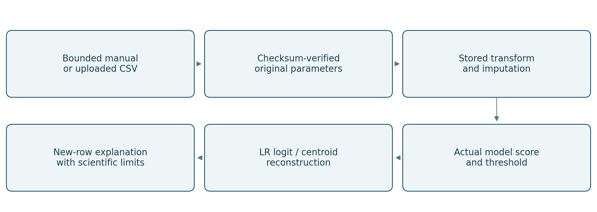


## 21. External validation

### Outcome and reproducibility

This study completes the prespecified external validation and bounded single-machine scalability investigation. It starts from 74e909ac3771dcaf5730437d3567f24c4fa4913b and reuses finalized Phase 13 at ab6e9401b0c9b92e624e5b2b16ec91050a081eb0. Recovered 14D version 1 was accepted without repeating any measured experiment. Stage 14E version 1 supplies the remaining actual optimization/Pandas/inference/mining evidence. The experiment manifest and final independent acceptance receipt are authoritative; source versions, logs, component hashes and raw repetitions are retained. The final remote commit is independently checked after pushing, avoiding a self-referential SHA in this report.

### Research questions and study design

RQ14.1–3 address conditional cross-dataset transfer, target baselines and feature mismatch. RQ14.4–7 cover data volume, worker threads, storage formats, partitions/cache. RQ14.8–10 address bounded Pandas comparison, workload costs and limits of the observed infrastructure. The frozen protocol is docs/phase14_research_protocol.md, prespecified at e0347bc57d650acaec2de83bdee2ad7ca5e8c23a. Documented amendments retain failed attempts, raw label bytes, unit identity checks, independent no-fit verification, corrected error sampling and the secondary grouped sampling-budget deviation. No outcome-driven model, feature, threshold or benchmark selection was introduced.

### Datasets, provenance and engineering

The source is the pinned 16,232,943-flow MMDS release, including 14capture-only flags,13,484,708 benign and 2,748,235 attack flows. It is not represented as the complete official CSE-CIC2018 corpus. Source upstream extraction revision and complete provenance remain unauthenticated.

External dataset shadman1028/cicids2017-official-flow-feature-csv-files/version 1 is an eight-file884,645,759-byte CICIDS2017 mirror with explicit UNB attribution. Capture dates are 3–7July2017. Mirror metadata declares CC BY 4.0 and noncommercial research use; this is not an independently authenticated official-byte or relicensing guarantee. Original attribution is preserved in docs/phase14_external_dataset_provenance.md.

The audit reconciles2,830,751 physical lines as 8 headers plus 2,830,743 eligible data records, with 2,273,097 benign and 557,646 attacks and no excluded data records. Fifteen traffic labels remain separate from the source family map. Three WebAttack labels contain literal UTF8 U+FFFD bytes already present in the mirror; no punctuation was guessed. Exact-observation duplicate excess is 308,381. Canonical 18-vector excess is 834,808with1,343conflicting-label groups; common 3excess is 1,540,628with4,150conflicting-label groups. These definitions are distinct. Private typed/canonical/feature-ready Parquet layers are version-pinned; raw records stay private.

Missing/nonfinite/negative numerical values follow the documented finite mask and train-only imputation. The mapped audit records 115 negative durations,2,867 infinite packet rates,1,358 NaN byte rates and 1,509 infinite byte rates. Full numeric-column diagnostics cover 78 features. Event timestamps are unavailable; capture dates come from filenames and cannot establish within-capture order.

### Feature compatibility and inference contract

Only duration(microseconds), forward packet count and backward packet count are conditionally harmonized, in that exact order. The label-free duration×rate/total-packets identity is within 1%of 1,000,000 for all 16,137,169 supported source and 2,827,761 external rows. This supports a unit convention, not exact extractor equivalence. Fifteen other feature semantics remain unverified. Original archived 18-feature external transfer E1 is unsupported and was not scored by invented zeros or guessed units.

E2 fits new source-only common 3 pipelines and freezes their preprocessing/calibration for target inference. They are not the original 18-feature archived pipelines. E3 fits separate target-only preprocessing/models. The saved artifact registry, ordered schema, original component hashes, missing-value handling and operating bins are described in docs/phase14_inference_contract.md. Six learned LR/RF pipelines and six controls total 12 saved pipelines; 150 component hashes and independent prediction/calibration reload evidence are preserved.

### External protocols, populations and leakage control

Primary external chronology trainsJuly3–5, validatesJuly6 and evaluatesJuly7. Common-vector earliest-role purging retains multiplicity in its earliest role. The primary chronological test contains 308,939 flows:179,664 benign and 129,275 attacks. Conservative source-exposure exclusion leaves 287,528. Secondary grouped primary/excluded denominators are 508,641/218,235. Every source/target comparison uses matched rows for its declared sensitivity. Cross-dataset canonical/common collisions are feature collisions, not authenticated duplicate network events.

Source common-model training has 169,599 rows; chronological target training172,913; grouped target 287,498. Source group sampling is 125/10000 and chronological target 1000/10000. Shared grouped role/sample hashing gives approximately1/7 of eligible grouped training keys rather than an independent 10%within-role sample. Actual budgets are independently documented; equal training effort is not claimed.

Models use frozen LR12 iterations/regParam.05 and RF12 trees/depth 5/minInstances 30/maxBins 24/seed 23013. Majority and training-duration controls remain separate. Operating bins maximize validation recall subject to benignFPR<=1%, with prespecified ties. Bin2048means never-positive. Fixed0.5results are separate. No target-test outcomes fit preprocessing or choose thresholds. AUC uses 2048whole-score bins:step PR and trapezoidal ROC, not exact continuous-score AUC. Undefined metrics remain null.

### External results and negative findings

| Pipeline | Operating rule | TP | FP | TN | FN | Recall | FPR | F1 | PR area | ROC area |
|---|---|---|---|---|---|---|---|---|---|---|
| E2-B-common-LR | validation_budget | 0 | 0 | 179664 | 129275 | 0 | 0 | 0 | 0.420307 | 0.534453 |
| E2-B-common-LR | fixed_half | 0 | 0 | 179664 | 129275 | 0 | 0 | 0 | 0.420307 | 0.534453 |
| E2-B-common-RF | validation_budget | 14459 | 7643 | 172021 | 114816 | 0.111847 | 0.0425405 | 0.191033 | 0.746094 | 0.823381 |
| E2-B-common-RF | fixed_half | 14491 | 10302 | 169362 | 114784 | 0.112094 | 0.0573404 | 0.188112 | 0.746094 | 0.823381 |
| E3-chronological-LR | validation_budget | 0 | 229 | 179435 | 129275 | 0 | 0.0012746 | 0 | 0.368629 | 0.460811 |
| E3-chronological-LR | fixed_half | 9 | 19950 | 159714 | 129266 | 6.9619e-05 | 0.111041 | 0.000120616 | 0.368629 | 0.460811 |
| E3-chronological-RF | validation_budget | 7028 | 70 | 179594 | 122247 | 0.0543647 | 0.000389616 | 0.10307 | 0.872554 | 0.875103 |
| E3-chronological-RF | fixed_half | 83969 | 3093 | 176571 | 45306 | 0.649538 | 0.0172155 | 0.77628 | 0.872554 | 0.875103 |


Source LR detects zero attacks on the primary chronological external population. Source RF's source-calibrated operating point recalls11.18%but incurs4.254%target benignFPR, exceeding its source-validation ceiling. Target RF improves PR ranking and fixed-half recall(64.95%)but has 1.722%FPR at 0.5; its validation-budget rule reduces recall to 5.44%with 0.039%FPR. Target LR remains weak. Target training therefore does not uniformly improve operational performance. These are historical conditional findings, not production robustness.

All 64evaluation records, original family/capture histograms, threshold comparisons, coverage, calibration and timing remain in the compact evidence and derived tables. Original external families are retained; absent-family metrics remain undefined. Source/external comparisons use independent same-E2-model source holdout diagnostics to avoid mistaking18-versus3-feature changes for pure domain effects. Conservative collision exclusions change denominators and are not silently combined with primary results. Distinct-group error explanations use bounded representative/enriched samples and suppress contribution/score values for strata smaller than5. Their log-odds attributions are descriptive, not causal.


Evidence source:reports/phase14_research_report.md


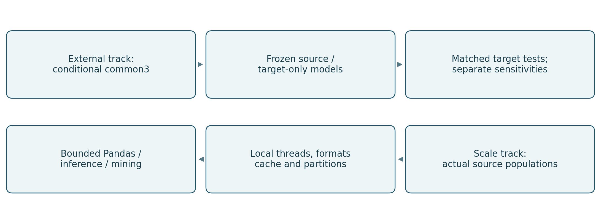


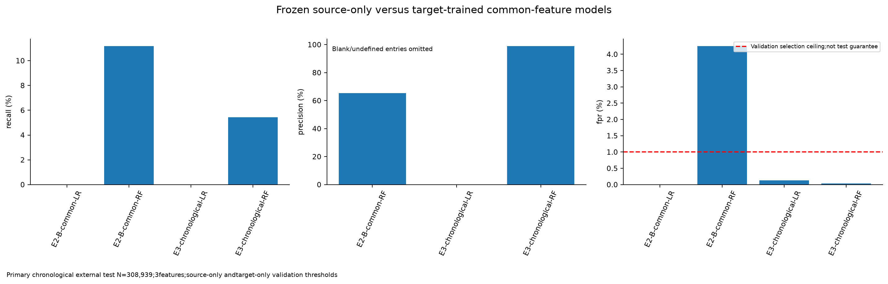


## 22. Scalability and execution optimization

### Volume and worker scalability

14Duses four genuinely nested fingerprint-hash populations, without replicated rows. Three workloads consume actual numeric columns:input checksum, class/day analytics and model preprocessing/vector aggregation. Three repetitions plus separate warmups run atlocal[4],16 partitions, AQEfalse, no explicit cache.48measured runs and 16 warmups pass exact integer and tolerance-based numerical equivalence. Actual medians are:

| Actual flows | Numeric checksum s | Analytics s | Feature transform s |
|---|---|---|---|
| 1000860 | 0.942887 | 0.741611 | 3.63679 |
| 3998178 | 1.48661 | 0.86291 | 8.7739 |
| 7998515 | 2.2437 | 1.14346 | 12.6707 |
| 16232943 | 3.93776 | 1.81335 | 21.0757 |


Worker sensitivity uses the same approximate1Mpopulation and newSparkContexts in a shared notebookJVM:

| Workload | Threads | Median s | Speedup T1/Tp | Efficiency |
|---|---|---|---|---|
| analytics | 4 | 0.741611 | 0.957028 | 0.239257 |
| feature_transform | 4 | 3.63679 | 1.00245 | 0.250613 |
| analytics | 1 | 0.709743 | 1 | 1 |
| feature_transform | 1 | 3.6457 | 1 | 1 |
| analytics | 2 | 0.458344 | 1.54849 | 0.774247 |
| feature_transform | 2 | 2.75461 | 1.32349 | 0.661745 |


Four workers are not consistently faster. Warm JVM, short actions, uncontrolled filesystem cache and shared hardware preclude a general linear-scaling or optimal-worker claim. local[1]/[2]/[4]are threads on one machine, not multi-node clusters. Full16,232,943 rows were measured in the primary matrix; bounded secondary comparisons do not replace that core requirement.

### Storage, partition and cache measurements

14Euses the accepted14D1,000,860-row population. Both matchedCSV andParquet preserve identical numerical values, labels, multiplicities and lossless hexadecimal fingerprints. Logical-row digests, numeric sums andquery outputs pass correctness parity. Conversion is separate from read/query timing. Count-only metadata optimization is explicitly labeled and never substituted for a forced numeric read.

| Format | Bytes | Conversion s | Full numeric read s | Projected query s |
|---|---|---|---|---|
| parquet | 116203334 | 6.57791 | 0.626799 | 0.398523 |
| csv | 217833168 | 3.33495 | 1.92177 | 1.2544 |


| Matrix | Configuration | Rows | Repetitions | Median s |
|---|---|---|---|---|
| partition_materialization | 4 | 1000860 | 3 | 3.01877 |
| partition_query_after_materialization | 4 | 1000860 | 3 | 0.406834 |
| partition_materialization | 16 | 1000860 | 3 | 2.66868 |
| partition_query_after_materialization | 16 | 1000860 | 3 | 0.328335 |
| partition_materialization | 48 | 1000860 | 3 | 2.88296 |
| partition_query_after_materialization | 48 | 1000860 | 3 | 0.408467 |
| cache | none | 1000860 | 3 | 0.428303 |
| cache | first_materialization_MEMORY_AND_DISK | 1000860 | 1 | 3.10564 |
| cache | warm_materialized | 1000860 | 3 | 0.291111 |
| archived_inference | logistic_regression | 1000860 | 3 | 1.90268 |
| archived_inference | random_forest | 1000860 | 3 | 2.22452 |
| pattern_mining | Phase10A3-frozen6-support.05-one_budgeted_fit | 100000 | 1 | 3.02524 |


Partition materialization costs are separated from subsequent queries; capture pruning and coalescing are retained. SQL and DataFrame consume identical filtered aggregation outputs. Cache first-materialization is one explicit action; uncached/warm queries have three retained repetitions. Cache amortization uses materialization/(uncached minus warm), defined only when warm queries are faster. The observed break-even is 23 queries under this measured boundary; it is not a deployment guarantee or eviction observation. OS cache was not flushed.

### Bounded Spark versus Pandas

Exactly matched projected CSV rows, dtypes, filters, grouping and numerically consumed results are compared at 100k/500k/1M. All three repetitions are retained for each engine and boundary:

| Matched flows | Timing boundary | Pandas median s | Spark median s | Spark/Pandas time |
|---|---|---|---|---|
| 100000 | input_loading | 0.0280377 | 0.215526 | 7.68701 |
| 100000 | end_to_end | 0.0320017 | 0.254853 | 7.96373 |
| 100000 | compute | 0.010115 | 0.118304 | 11.6959 |
| 500000 | input_loading | 0.114861 | 0.450503 | 3.92217 |
| 500000 | end_to_end | 0.118059 | 0.357022 | 3.0241 |
| 500000 | compute | 0.0187425 | 0.130041 | 6.93832 |
| 1000000 | input_loading | 0.235318 | 0.719309 | 3.05675 |
| 1000000 | end_to_end | 0.242245 | 0.616481 | 2.54486 |
| 1000000 | compute | 0.0292257 | 0.147055 | 5.0317 |


Input-loading includes parsing plus the same consumed numeric checksum. End-to-end includes parsing/filter/aggregation. Compute uses already loaded Pandas data and materialized Spark data. SparkContext startup is separately recorded; Python/Pandas import/setup is not an independently isolated engine-startup measurement. There is no full16MtoPandas conversion. These results compare a bounded workload on observed hardware; they cannot establish universalSpark superiority. Execution order, OS cache and startup differences remain visible limitations.

### Workload costs, resources and variability

Archived Phase4B18-feature LR/RF inference forces actual probability sums and positive decisions, with three repetitions. These are internal source benchmark models, not the unsupported external18-feature transfer. The bounded Phase10A3 FP-Growth cost uses at most100ktransactions and original 6 feature discretization/minSupport.05; one fit is explicitly budgeted cost evidence, not stable mining scalability. Source/target fitting costs come from completed14C; Phase6replay reuses49 microbatches and 15,322,987 flows rather than retiming completed work.

Kaggle observes fourCPUquota threads,8GiBdriver heap and 30GiBcontainer memory on virtualizedIntelXeon2.20GHz hardware. RSS is sampled every0.2 seconds, with Python, JVM and process-tree peaks separate; configured heap is not measuredRSS. CPU process-tree deltas are reported only when process membership is stable. Pandas actions share the resident Spark JVM; their process-tree RSS is an environment peak, not isolated Pandas memory or incremental engine allocation. Actual shuffle/spill/task imbalance/eviction metrics remain unavailable. Resource limits reserve3GiBscratch and stop subsequent heavy work above20GiBsampled treeRSS. Whole-stage receipts and raw repetitions record observed versions and resources. Local Python 3.12validation and KagglePython3.13execution are not claimed identical.

### Persistence, figures and laboratory

Versioned outputs and the experiment/model/dataset manifests preserve provenance and SHA256s. Independent14Vreconstructs stored calibration histograms and verifies same-model source holdout, training support, unit identities and imputed-vector collisions without refitting. Original local fresh-process reload receipts cover all 12 pipelines. Raw datasets, serialized weights and detailed private case records stay private.

There are 17publication figure families inPNG/SVG, covering all 24prespecified scientific topics through combined panels. Each has actual table provenance and SHA256. The isolated Phase14Streamlit laboratory provides20evidence sections, filters, denominators, undefined/empty states, confusion matrices, resource units andPNG/SVG/filteredCSVdownloads. It displays archived evidence; there is no deployment or livePhase15inference flow. Actual desktop/mobile and byte-identical filtered download checks are retained in reports/phase14_validation.

### Acceptance and limitations

The final suite preserves 161existing tests and adds 3benchmark-evidence acceptance tests. Final regression, independent arithmetic and benchmark acceptance, artifact hashes, figure provenance, preview/browser checks, manifest/report consistency and protected Git references must all pass before the experiment manifest is marked complete. The final receipt is reports/phase14_validation/acceptance.json.

Limitations include conditional extractor semantics, unverified upstream byte chain, historical testbed selection, coarse-vector purging, disclosed grouped training budgets, correlated flows, finite captures, approximate AUC, bounded/enriched explanations, shared warmed hardware, uncontrolledOS cache, sampled resource peaks, one mining fit and unisolated Python/Pandas import overhead. No causal, production, multi-node, billion-row or universal performance conclusion is made. Exact18-feature external transfer and optional novelty/hybrid/adaptive transfer remain unsupported/omitted under the frozen protocol.

### Research contribution and continuation boundary

The study combines auditable common-feature external validation with matched numerical workload benchmarks on actual full-volume source data. It separates model changes, calibration, feature compatibility and dataset selection from operational detection claims, and distinguishes volume/worker/storage/cache effects. Negative findings are retained alongside correctness evidence. Completion prepares review ofPhase15; noPhase15orPhase16implementation is included.


Evidence source:reports/phase14_research_report.md


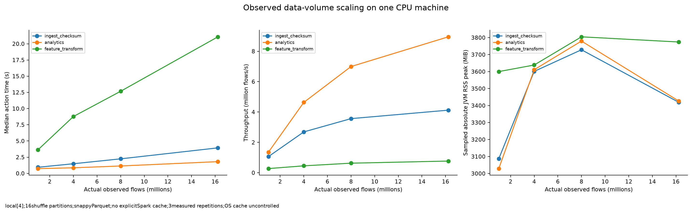


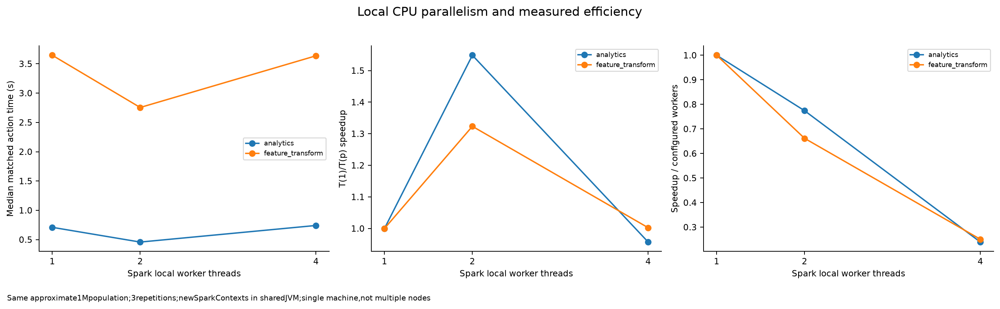


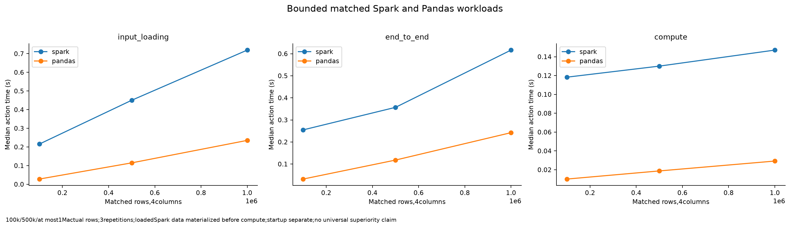


## 23. Integrated dashboard and interactive inference

### Checkpoint and preserved research

Start 51392548c562d098e3d74b9a0bda4c402bd421d7. The Phase 15 protocol was committed before inference implementation. The research-v2 branch contains only the new advanced application, compact owner-authorized parameter artifacts, tests and documentation. All Phase 1–14 research and the public dashboard/app.py remain unchanged. Final remote identity is checked after the final push to avoid a self-referential commit hash. No public deployment or Phase 16 work was performed.

### Architecture and reusable integration

The separate entry point is dashboard/advanced_app.py. Thirteen application modules comprise executive overview, nine research areas, actual inference, historical replay and evidence/reproducibility. The catalog references 203 existing CSV/JSON tables, plus original figures with path/hash lineage. Source phases and protocols remain visible. Dataset/SQL and engineering, supervised/hybrid, clustering/novelty, multiclass/open-set/pipeline gates, patterns, streaming/drift, adaptive learning, explainability and external validation/scalability all retain their actual evidence.

The runtime uses only Streamlit, pandas, Altair and standard Python. It does not require Java, Spark, Kaggle credentials or private model access. Only immutable research evidence is globally cached. Uploaded records and predictions are not cached across sessions, persisted or sent to third-party services. CSV downloads are bound to the displayed evidence identity. The baseline entry point and deployment remain separate.

### Executable models and identity

The minimum prespecified set contains exact archived Phase 4B Logistic Regression and Random Forest, and Phase 5B K-Means. Hybrid, multiclass/open-set and direct tree SHAP are research-only. No replacement model was trained. The compact JSON artifacts preserve active feature order, training medians, scaler flags/std/mean, LR coefficients/intercept, RF continuous splits/leaf probabilities/tree weights, and K-Means signed-log1p/centroids. Original component hashes and source versions are in manifests/phase15_models.json.

| Model | Original source/version | Spark parity probes | Maximum score residual | Portable SHA256 |
|---|---|---:|---:|---|
| B-logistic_regression | ramcharan2345/mmds-phase-4-supervised-attack-detection/2 | 100 | 1.5265566588595902e-16 | 4e76894c0a8705e8eec97579d32911cbac9a2b8f1dcfbdd6338b3bb2101ab17f |
| B-random_forest | ramcharan2345/mmds-phase-4-supervised-attack-detection/2 | 2245 | 1.1102230246251565e-16 | 71df65469593e09cd0acbeab15b4e6a347b137920f7322562ca18b94f06c3900 |
| B-kmeans | ramcharan2345/mmds-phase-5-clustering-pattern-evolution/2 | 100 | 4.3655745685100555e-11 | 82891bc314c4b6c7c60e1d0d4c287db78cd3c82b0fc306e5b2ba59173d2e8578 |

All 2445deterministic missing, zero, unit, extreme finite, random and forest split-boundary probes match original Spark4.3.0 pipelines. LR/RF probability tolerance is 1e-10;K-Means squared-distance tolerance is 1e-8relative/absolute. Every threshold decision and assigned cluster agrees. Derived artifacts total about224 KiB, contain parameters rather than private training records, and are distributed under the owner's requested application integration;the original source mirror declaresApache2.0. Uncertain upstream provenance remains documented.

### Manual inference and explanations

All three models execute from an18 feature form. Blank fields use stored training medians. Names, available units and extraction caveats accompany inputs. Finite nonnegative inputs are capped at 1e12;invalid inputs produce errors rather than predictions. Source-training min/max warnings are descriptive, not a guarantee of model validity on another extractor. Synthetic presets are explicitly numeric fixtures, not captured or necessarily physically consistent flows.

Results show the actual score, decision threshold, model identity, imputation count and limitations. LR signed contributions plus intercept reconstruct the new record's logit. K-Means feature deviations reconstruct squared distance to the actual assigned centroid after signed-log1p, imputation and scaling. RF predictions are genuine, but local tree SHAP is unsupported;archived native importance is global research evidence. No archived local explanation is substituted for an uploaded record. No score is labeled calibrated confidence or causal evidence.

### CSV ingestion, alignment and export

The exact ordered18 feature schema is required. UTF8/BOMCSV is limited to1 MiB/500 logical rows. Missing/extra/reordered/duplicate headers fail explicitly. Per-row numeric/nonfinite/domain/column-count errors retain row numbers and invalid status;valid observations are scored without fitting preprocessing. The demonstration CSV has three synthetic rows. Browser acceptance verifies a valid three-row batch and a four-row mixed batch with its invalid row retained, plus incompatible-header rejection. Prediction downloads match independently computed output bytes. A valid uploaded row can be selected for a newly computed model explanation. Bounded results remain only in session memory and are cleared when the upload identity or model changes. Formula-leading text is escaped for spreadsheet export;numeric negative result values retain numerical representation.

### Historical replay and research interpretation

Capture, replay-position and microbatch controls select original Phase 6records. The app joins actual archived detection, novelty, distance and alert evidence for the chosen window and displays its volume/latency. Phase 12adaptive model versions are labeled as a separate retrospective experiment rather than retroactively assigned to the Phase 6replay. No packet capture, new attack events, live monitoring or autonomous retraining was introduced.

All negative findings remain visible:weak chronological generalization, source LR's zero primary external detections, source RF's exceeded validation FPR ceiling, conditional common3rather than original18 feature transfer, and non-monotonic local worker speedups. At1Mmatched rows Phase 14Pandas end-to-end median0.242s versusSpark0.616s remains in its original table. No universalSpark, multi-node, production or causal claim is made.

### Model registry, security and resource controls

Artifacts are checked against recorded SHA256before use;missing/corrupt/unsupported representations disable inference with no fallback. CSV/manual paths share the same schema/domain parser. Uploads stay inside the app process and are not used for training. Tree traversal is bounded;small artifacts and500row budgets keep runtime practical. Shared caches contain immutable research evidence only. Deployment/server logs and host policies still apply;this is not a production authentication/tenant service. Source-domain and finite-probe parity limitations remain explicit.

### Browser and integration acceptance

AppTest passes all 13modules, all 3manual models, missing-model/empty/undefined states. Chromium verifies nine research areas and supported filters with exact downloaded CSV identities, all 3manual predictions, invalid manual input, valid/mixed/invalid CSV, actual prediction downloads, explanation rendering, historical replay, provenance and a real temporarily unavailable-model state restored afterward. Desktop/mobile screenshots are genuine. Final browser scope passes with no page errors, unexpected HTTP errors or mobile main-content horizontal overflow. Research-area assertions may be retained from a preceding browser scope while affected inference/mobile controls are retried;the receipt marks that scope explicitly.

Screenshots: overview-desktop.png, inference-desktop.png, replay-desktop.png, overview-mobile.png, inference-mobile.png. Synthetic CSV:dashboard/data/phase15_demo.csv. Demonstration steps are in docs/phase15_demo_guide.md. No private historical input row appears in screenshots or committed prediction fixtures.

### Regression and completion

All 180 tests pass with zero failures, errors or skips, preserving 164 baseline tests plus 16 new input/model/evidence/parity/security contract tests. Full-suite runtime is 169.642seconds. Existing Spark4.3.0compatibility is preserved. The independent completion validator checks original model identity, portable hash/parity binding, numerical explanations, batch alignment, all catalog/figure hashes, UI/download evidence, documentation, regression and protected references. The final receipt is reports/phase15_validation/acceptance.json.

### Deployment preparation and limitations

Use a separate service with Python3.12 and dashboard/requirements.txt:

```bash
pip install -r dashboard/requirements.txt
python -m streamlit run dashboard/advanced_app.py --server.address 0.0.0.0 --server.port 8501 --server.headless true --server.maxUploadSize 1 --browser.gatherUsageStats false
```

No public deployment is claimed or authorized. Preserve the existing public baseline service. Exact deployment, artifact requirements, troubleshooting, inference and limitation documentation are in docs/phase15_*.md. Interactive source models are not validated production detectors. Their bounded Spark parity is numerical compatibility evidence, not a generalization guarantee. K-Means novelty is not attack probability, and LR attributions are not causal. Historical replay and simulated label availability are not real-world live monitoring. Phase 16has not begun.


Evidence source:reports/phase15_results.md


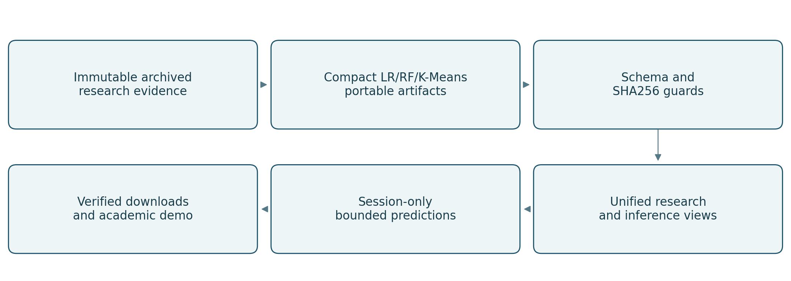


## 24. Experimental results and comparative analysis

The master results table is deliberately long-form: each row has a claim identifier, source path, exact selector, metric, denominator and interpretation. It allows comparisons only when the experiment supports them. Source A/B/C random forests share an algorithm family but have different fits and test populations. External E2/E3 comparisons share target rows but use different training domains and frozen calibration. Adaptive primary policies share issued forward observations, while late-period B and synthetic streams remain separate.

The main scientific pattern is a separation between random-split success and difficult future evaluation. The full-cohort Phase 4 random forest recall falls from approximately 82.8%on grouped-random A to about 0.2%on chronological B. This does not establish a single causal reason: family exposure, feature distributions, calibration and cohort purging all change. Phase 13 provides descriptive decomposition and distribution evidence, not causal identification.

Common-feature external evaluation preserves similarly important negatives. Source-only LR detects no primary chronological target attacks. Source RF's target benignFPR exceeds its source-validation ceiling. Target RF improves ranking and fixed-half recall but can sacrifice substantial recall under a stricter selected operating bin. These observations support careful operating-point and compatibility analysis, not a universal model ranking.

Computational evidence is also conditional. Four local threads are not consistently fastest, and Pandas is faster on the bounded matched four-column query. Parquet improves the measured numeric-read/query costs, while cache materialization requires repeated reuse to amortize. Every conclusion is tied to the measured workload, actual row count and stated environment.


## 25. Research contributions

The first contribution is an auditable data and evaluation chain across the exact 16,232,943-flow source release, with predictor-equivalence role separation, training-only transforms and retained denominators. The second is a coherent negative-result account of temporal/family generalization, calibration, novelty, fusion and delayed-label adaptation.

The third contribution is model-level numerical assurance: exact LR logits, centroid distance, hybrid paths, validated linear SHAP and portable LR/RF/K-Means execution have explicit reconstruction or parity checks. The fourth is a matched computational study that forces consumed numeric/model outputs and distinguishes workload scale, threads, format and cache. The fifth is a demonstration-ready research application and an academic package whose figures, tables and claims are content-addressed.

These contributions are supported within this project. There is no claimed new classifier, benchmark superiority, causal attack discovery, prospective live defense validation or multi-node scaling theorem.


## 26. Scientific and technical limitations

The source mirror's upstream description and extraction revision are incomplete. The external mirror has explicit institutional provenance but no independently authenticated official-byte chain. Both are historical laboratory releases with capture-specific compositions. Exact cross-dataset event identity is not established, and common-vector collisions are not proof of duplicate events.

Repeated flows, finite capture days, group-aware sampling, approximate binned AUC, retrospective label release and bounded enriched cases limit statistical interpretation. Flow rows are not independent replications. Descriptive seed/repetition/capture-deletion ranges are not universal confidence guarantees. The secondary grouped target training budget is larger than an independent 10%within-role sample because it shares a keyed hash with role assignment.

Direct interventional tree SHAP and original 18-feature external transfer remain unsupported. Novelty is not probability; association is not causation; historical replay is not live monitoring. Single-machine SparkContexts can share a warmed JVM and uncontrolled filesystem cache. Sampled RSS can miss transients, and Pandas process-tree memory can include a resident Spark JVM. Public deployment, authentication/tenant hardening and prospective operational validation remain future work.


## 27. Conclusion

The completed project demonstrates that large-scale cyberattack research can be made reproducible without hiding weak or negative results. Its most consequential findings are the collapse of some chronological operating points, the mixed value of fusion and adaptation, the difficulty of defensible feature transfer and the workload dependence of computational performance.

The final application computes genuine archived-model predictions and supported explanations while retaining source identities and bounds. Its usability and numerical compatibility are verified separately from detection quality. The final academic package closes the engineering and reporting workflow; it does not convert retrospective evidence into a claim of production readiness.


## 28. Future work

Future research could authenticate upstream extractor revisions, obtain prospective captures with legitimate ground truth, evaluate a prespecified common-feature transfer model on new untouched data and study calibrated operating policies under realistic analyst costs. Any new model selection would need fresh protocols and independent cohorts.

Engineering extensions could add a separately authorized hosted service, stronger access controls and tenant isolation, carefully monitored model lifecycle management and genuine multi-node benchmarks. These are proposals only. They are not implemented Phase 17 work or evidence already established by this submission.


## 29. References

[1] Matei Zaharia, others. Apache Spark: A Unified Engine for Big Data Processing. Communications of the ACM, 2016. DOI: 10.1145/2934664

[2] Xiangrui Meng, Joseph Bradley, Burak Yavuz, Evan Sparks, Shivaram Venkataraman, Davies Liu, Jeremy Freeman, DB Tsai, Manish Amde, Sean Owen, Doris Xin, Reynold Xin, Michael J. Franklin, Reza Zadeh, Matei Zaharia, Ameet Talwalkar. MLlib: Machine Learning in Apache Spark. Journal of Machine Learning Research, 2016. https://www.jmlr.org/papers/v17/15-237.html

[3] Leo Breiman. Random Forests. Machine Learning, 2001. DOI: 10.1023/A:1010933404324

[4] Jerome H. Friedman. Greedy Function Approximation: A Gradient Boosting Machine. The Annals of Statistics, 2001. DOI: 10.1214/aos/1013203451

[5] Jiawei Han, Jian Pei, Yiwen Yin. Mining Frequent Patterns without Candidate Generation. Proceedings of the 2000 ACM SIGMOD International Conference on Management of Data, 2000. DOI: 10.1145/342009.335372

[6] Albert Bifet, Ricard Gavaldà. Learning from Time-Changing Data with Adaptive Windowing. Proceedings of the 2007 SIAM International Conference on Data Mining, 2007. DOI: 10.1137/1.9781611972771.42

[7] João Gama, Indrė Žliobaitė, Albert Bifet, Mykola Pechenizkiy, Abdelhamid Bouchachia. A Survey on Concept Drift Adaptation. ACM Computing Surveys, 2014. DOI: 10.1145/2523813

[8] Iman Sharafaldin, Arash Habibi Lashkari, Ali A. Ghorbani. Toward Generating a New Intrusion Detection Dataset and Intrusion Traffic Characterization. Proceedings of the 4th International Conference on Information Systems Security and Privacy, 2018. DOI: 10.5220/0006639801080116

[9] Takaya Saito, Marc Rehmsmeier. The Precision-Recall Plot Is More Informative than the ROC Plot When Evaluating Binary Classifiers on Imbalanced Datasets. PLOS ONE, 2015. DOI: 10.1371/journal.pone.0118432

[10] Scott M. Lundberg, Su-In Lee. A Unified Approach to Interpreting Model Predictions. Advances in Neural Information Processing Systems, 2017. https://proceedings.neurips.cc/paper_files/paper/2017/hash/8a20a8621978632d76c43dfd28b67767-Abstract.html

[11] Feargus Pendlebury, Fabio Pierazzi, Roberto Jordaney, Johannes Kinder, Lorenzo Cavallaro. TESSERACT: Eliminating Experimental Bias in Malware Classification across Space and Time. 28th USENIX Security Symposium, 2019. https://www.usenix.org/conference/usenixsecurity19/presentation/pendlebury

[12] {Canadian Institute for Cybersecurity}. CIC-IDS2017 Dataset Documentation. University of New Brunswick, 2017. https://www.unb.ca/cic/datasets/ids-2017.html


## 30. Appendices and reproducibility instructions

Administrative fields on the title page are editable placeholders. Replace them with approved institutional details;no certificate,signature or approval is fabricated.

See the accompanying phase completion matrix and master results table for exact hashes and selectors. Reproduce verification from the repository using the established Python 3.12.14,Java 21,Spark 4.3.0 environment. Kaggle research archives require the owner-authorized KAGGLE_API_TOKEN secret scoped to www.kaggle.com and api.kaggle.com;never place its value in a document or source file. The deployed application uses compact public parameter artifacts and requires no Kaggle credential.

Run:python -m unittest discover -s tests -v. Launch the separate advanced app with python -m streamlit run dashboard/advanced_app.py --server.maxUploadSize 1. The final reproducibility and deployment guides contain the exact environment paths,checkpoint and private-artifact boundaries. Research reruns are not required for the academic submission.

The submission inventory and SHA256 file bind the documents,figures,tables,screenshots and demonstration fixture. The ZIP excludes credentials,private raw data,caches and full model archives. Publication and public advanced deployment have not been claimed.

Mathematical conventions: recall = TP/(TP+FN); benign FPR = FP/(FP+TN); precision = TP/(TP+FP). Undefined denominators remain undefined. A frozen threshold tau produces an alert when score(x) >= tau. Logistic probability is 1/(1+exp(-z)); additive linear SHAP reconstructs z, not the probability. K-Means novelty uses the minimum squared Euclidean distance to an archived center after its training-only transform. FP-growth support is count(A)/N and confidence(A => B) is count(A union B)/count(A). These definitions do not make associations causal or novelty scores probabilities.
