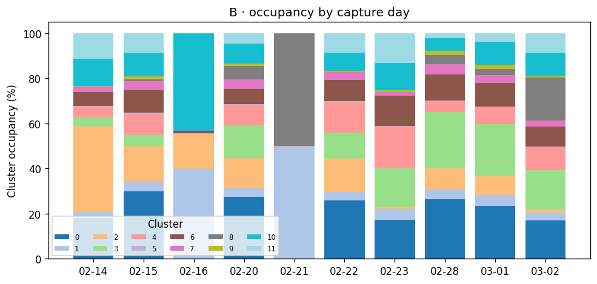
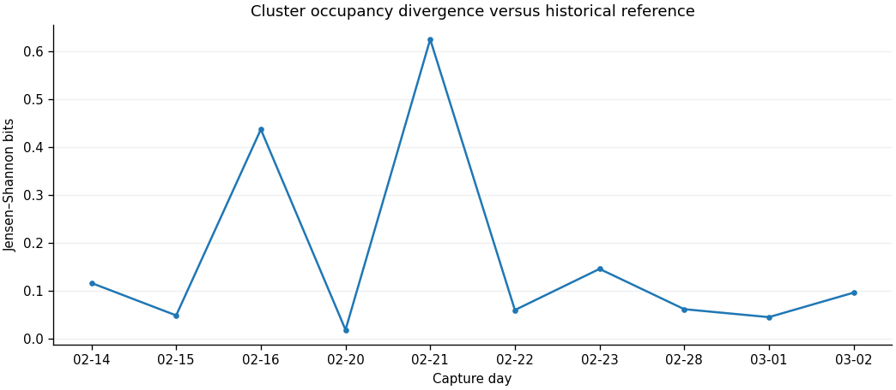

# Final project report

## Abstract

Large-Scale Cyberattack Detection and Evolving Attack Pattern Mining investigates how network-traffic models behave when moved from grouped-random evaluation to later capture days or a held-out attack scenario. The project processes 16,232,943 historical flows, evaluates leakage-aware alternatives, and replays 15,322,987 retained flows through Spark Structured Streaming. The evaluation exposes a substantial generalization gap and demonstrates reproducible historical monitoring.

## Problem and objectives

Traffic datasets contain repeated patterns, capture-specific conditions and strongly imbalanced attack families. Random evaluation can hide the operational difficulty of an unseen capture. The objectives were to audit a large dataset, define leakage-aware evaluation, characterize patterns without labels, verify streaming inference and recovery, and make the evidence available for faculty review.

## Dataset and Spark engineering

The Kaggle dataset `saisathwikregula/mmds-dataset-23013` contains 10 capture days. The canonical Parquet snapshot retains **16,232,943 flows**, including **13,484,708 benign** and **2,748,235 attack** records. The ingestion pipeline checks header variants, casts against an explicit contract, preserves source and content fingerprints, and materializes partitioned clean and feature-ready layers. Nonfinite values and configured sentinels follow explicit quality rules. The 14 anomalous timestamps remain usable for capture-day accounting and are excluded from intraday event-time aggregates. The recorded timezone is unverified. [Dataset provenance](../manifests/dataset_inventory.json) · [Cleaning policy](cleaning_policy.md) · [Phase 2 engineering](../reports/phase2_data_engineering.md)

## Exploratory analytics

Spark SQL and equivalent DataFrame queries produce daily traffic and prevalence, family support, protocol and port distributions, duration and packet or byte metrics, feature missingness, and selected Pearson correlations. The outputs report observation counts for missingness and pairwise statistics. The 410,707 excess exact copies are a separate check from predictor-group collisions and overlap across evaluation slices. Descriptive relationships depend on source conditions and do not identify a detection mechanism. [Phase 3 analytics](../reports/phase3_analytics.md) · [Pattern findings](attack_pattern_findings.md)

## Supervised models and generalization

MLlib Random Forest, Logistic Regression and GBT are compared with majority and duration baselines. A full-training Logistic Regression refit is distinct from the group-sample model. The shared predictor registry excludes labels, fingerprints, capture identifiers, ports, protocol and timestamps. Preprocessing is learned on training rows. Grouped random keeps a predictor group together. The chronological and Web holdouts purge later-split overlaps, then reconcile support. A frozen threshold of 0.5 defines the confusion metrics.

| Random Forest evaluation | Test flows | Attack prevalence | Recall | Binned PR-AUC |
|---|---:|---:|---:|---:|
| A · Grouped random | 2,432,292 | 14.97% | 82.82% | 0.9166 |
| B · Chronological | 980,109 | 21.28% | 0.20% | 0.6036 |
| C · Web capture holdout | 1,458,218 | 0.05% | 2.43% | 0.0005 |

PR-AUC is prevalence-sensitive. Comparison across rows calls for inspecting cohort construction and class support. In the later captures the duration rule recovered 82.76% of attacks at 44.81% precision. The Random Forest’s ranking and its frozen operating point tell different stories. [Phase 4 results](../reports/phase4_supervised_results.md) · [Model evaluation table](../reports/phase4_metrics.csv)

## Clustering and novelty

Reference-fit signed-log preprocessing and K-Means use label-free predictor vectors. The retrospective fit chose k = 5 with silhouette 0.6179. Historical and Web capture fits selected k = 12 with silhouettes 0.6289 and 0.6029. Cluster IDs are fit-specific. Alternative-seed assignment ARI ranged approximately 0.80–0.90, and the linear scaling comparison ranged approximately 0.22–0.42. That sensitivity matters for interpreting cluster stability.

Nearest-centroid squared distance is compared with a reference-only P95, P99 or P99.9 cutoff. Historical P99 flagged 21,042 test flows, with 2.13% attack recall and 21.09% precision. The Web holdout’s P99 achieved **55.78% recall** and **1.50% precision**. The flag can support inspection and does not establish that a flow represents an unknown attack. Unmatched novelty and supervised cutoffs do not establish comparative improvement. [Phase 5 results and figures](../reports/phase5_clustering_results.md)

## Historical streaming, monitoring and recovery

Phase 6 verified the exact published Phase 4/5 B artifacts and replayed **15,322,987 flows** in **49 microbatches**, after the 909,956-row overlap purge. A file-backed available-now source released chunks in a declared order. Resume after an interruption preserved the aggregate checksum and reconciled batch IDs with the checkpoint, supporting effectively-once accounting for the tested sink.

Fixed historical histograms benchmark input, score and cluster distributions with Jensen–Shannon divergence. Reference novelty rate and labeled recall use separate thresholds and minimum support. Alert records preserve category, severity, detector, threshold, evidence type and support. The run emitted **102 alerts**, including **62 high-severity** records. Some daily and intraday alerts refer to overlapping flows. Distribution changes and retrospective performance declines can coexist without establishing concept drift. [Phase 6 streaming results](../reports/phase6_streaming_results.md) · [Interpretation](phase6_drift_interpretation.md)

## Performance and scalability

The historical query took **862.32 seconds**, at **17,770 flows/s**, on one Kaggle CPU instance with four local Spark workers. Staging took **397.69 seconds** for 1.72 GB. JVM peak RSS was 9.38 GiB. A comparison over the same 944,675 flows ran in 63.02 seconds with one file per trigger and 47.84 seconds with two. The sequential single-node runs do not establish distributed scaling or a general speedup. [Benchmark details](../reports/phase6_performance.csv)

## Contributions, limitations and follow-up

The project contribution is the audited evidence chain, the shared leakage-aware test cohorts, the paired supervised and unsupervised analysis, and the restartable historical replay connected to an explorable dashboard. Spark, MLlib, K-Means, standard classifiers, Jensen–Shannon divergence and Streamlit are inherited technologies or algorithms.

The corpus has capture and label dependencies, repeated patterns, sparse scenarios, and unverified timezone. The training-recall reference is partly in-sample. The project does not establish operational detection efficacy, confirmed concept drift, cross-machine recovery or live monitoring coverage. Offline refresh was omitted because a defensible label-availability schedule was unavailable. A future study could use independent captures, verified labels, matched operating points, and multi-node fault tests.

The upstream notebooks and committed manifests retain run versions and evidence. The dashboard package rebuild requires only the compact reports. It enables the default faculty demonstration without reprocessing the corpus or starting Spark. [Reproducibility and quick start](dashboard_quickstart.md) · [Architecture](system_architecture.md) · [Evaluation](../reports/final_project_evaluation.md)
