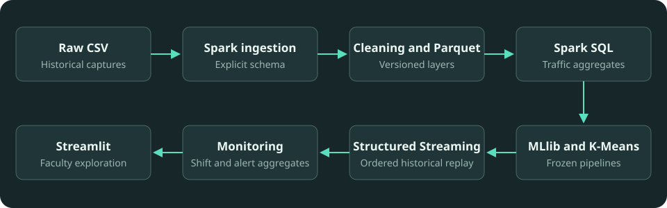
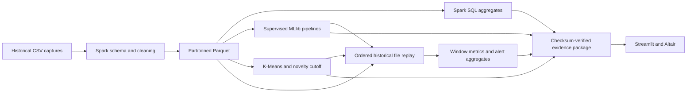

# System architecture

Phase 2 reconciles CSV rows and materializes provenance-aware Parquet. Phase 3 compares equivalent SQL and DataFrame aggregations on Spark 4.3.0. Phases 4 and 5 train separate supervised and unsupervised pipelines. Phase 6 applies the chronological B versions using bounded file-backed Structured Streaming, a checkpoint and an atomic aggregate sink. Phase 7 turns the saved reports into a browser application.

Capture-day provenance controls replay order. The original event time is wall-clock data with unverified timezone. It supplies three-hour windows when eligible. Synthetic sequence controls release order and UTC processing timestamps support latency measurement.

Labels and fingerprints support audit, evaluation and duplicate grouping. The 18 model predictors exclude audit identifiers, ports, protocol, labels, and time. Model and threshold fitting use reference data only. Web capture holdout is a scenario evaluation with sparse positive support. Kaggle measures one CPU node with four Spark workers. Streamlit requires only the evidence package. [Data contract](data_contract.md) · [Split design](phase4_experimental_protocol.md) · [Replay protocol](phase6_replay_protocol.md)
